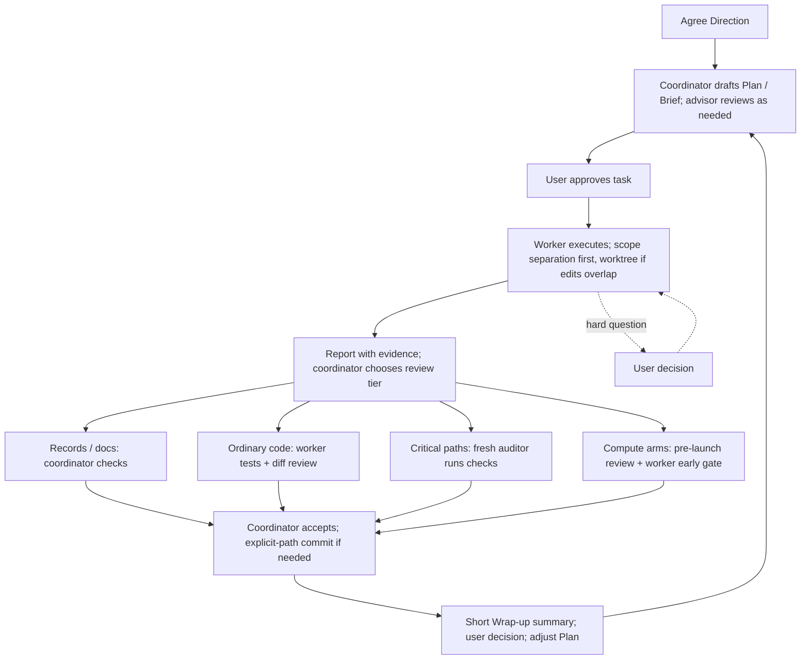

English | [中文](README.zh.md)

# agent-co-work

A portable multi-agent collaboration kit for any project folder on Unix-like hosts (macOS/Linux), built on Herdr (`hc`) and one standard-library Python CLI (`cw`).
You discuss direction with a coordinator, approve each task, decide hard questions, and review the coordinator’s conclusion-first summaries; an advisor supplies reviews when needed.
Any seat can run any supported agent CLI (`claude`, `codex`, `agy`); the three-agent setup is only an example, and the authoritative rules live in [skill cowork](skills/cowork/SKILL.md#task-loop).

## Before you start

Use macOS or Linux. **You never run `cw` or Python yourself**: discuss the work with the coordinator, review its plans, and confirm changes.

1. **Install [Herdr](https://herdr.dev/download/).** On Apple silicon macOS, download the [DMG](https://releases.herdr.dev/app/Herdr.dmg) and drag Herdr to Applications. On macOS or Linux, the installer is:

   ```sh
   curl -fsSL https://releases.herdr.dev/app/install.sh | sh
   ```

   Open a Herdr terminal, check `hc --version`, and ensure `~/.local/bin` is on `PATH` (or your custom `HC_INSTALL_DIR`). On macOS, grant terminal privacy requests to **Herdr Core**; existing Herdr.app grants do not transfer.
2. **Install and log in to at least one agent CLI:** `claude`, `codex`, or `agy`. That CLI becomes your coordinator; one is enough, and the coordinator detects installed CLIs and recommends seats from those available.
3. **Have `python3` 3.9+ and `git` installed** (on macOS, from `xcode-select --install`).
4. **GitHub access:** none once public (the public kit uses HTTPS `git clone` and needs no GitHub key); while a repository is private, it needs your own normal GitHub credentials.

## Start your first coordinator

Open Herdr, use **`+`** in the tab bar to create a space/tab in your project folder, and start whichever coordinator CLI you chose (`claude`, `codex`, or `agy`). A session name is optional (recommended when your CLI supports it).

```text
1. Open Herdr → + → your project folder.
2. Start the coordinator CLI you chose (a name is optional), for example:
   - Claude Code: claude -n yyyymmdd-coordinator   (or: claude)
   - Codex:       codex
   - agy:         agy
3. Paste the coordinator prompt below, filling in <project description>.
```

### Coordinator prompt

```text
Set up or upgrade agent-co-work in this project. For a new installation, if
~/.agent-co-work is missing, run:
git clone https://github.com/YitaoXU/agent-co-work.git ~/.agent-co-work
Otherwise update the release with git -C ~/.agent-co-work pull --ff-only.
For an existing install, use cowork/cw upgrade to pull and show the plan;
if that command is unavailable, use the legacy bootstrap in cowork-init.
Read ~/.agent-co-work/skills/cowork-init/SKILL.md. Detect installed agent CLIs
and models, propose a recommended seat table using only those available,
and ask keep defaults / adjust seats. For adjustments, ask one question
per seat: its default / type your own agent model effort [life].
Show the final table, file plan and kit SHA. Apply only after my confirmation,
then run cowork/cw lint and compare its SHA. Use the description below to
prepare this project's Direction and Plan.

<project description>
Goal:
Current state:
Key folders and documents:
What to do first:
```

## What you do afterwards

- **Confirm seats and the install plan (new project):** Review the coordinator's recommended seats (including `discussion`), built from your installed CLIs. Choose **keep all defaults** or **adjust seats** (for each adjusted seat, pick its default or type `agent model effort [life]` from the listed valid values). Then confirm the complete seat table, file plan, and kit SHA before the coordinator applies it, and check the installed SHA against the plan.
- **Upgrade an existing project:** Tell the project's coordinator to **upgrade**, review the upgrade plan and kit SHA it shows, confirm before it applies, and check that the installed SHA matches the confirmed plan.
- **Ask for a discussion seat:** Ask the coordinator to open a discussion (name an agent if you prefer), switch to the Herdr tab it gives you, and discuss directly there. Ask explicitly if you want it to edit project files, and let it know when you end the discussion so it reports conclusions and open questions back to the coordinator.
- **Approve Briefs and decisions:** Give the coordinator your project description, discuss Direction and Plan, approve each task's Brief before launch, decide hard questions when escalated, and review the coordinator's short conclusion-first Wrap-up summaries to agree on next steps.
- **Work while you are away:** Say roughly how long you will be away, answer the coordinator's questions, and say **go** to approve the [away plan](skills/cowork-away/SKILL.md); read its summary when you return.

## Seat setups

Any seat can run any supported CLI (`claude`, `codex`, or `agy`); single-CLI setups work with Claude, Codex, or agy, and the coordinator proposes a table using only what you have installed. Each cell lists `agent model effort life`.

| seat | Claude only | Codex only | Claude + Codex | Claude + agy + Codex (shipped default) |
|---|---|---|---|---|
| `coordinator` | `claude claude-opus-5-5 high long` | `codex gpt-6-astra high long` | `claude claude-opus-5-5 high long` | `claude claude-opus-5-5 high long` |
| `coordinator-alt` | `claude claude-opus-5-5 high long` | `codex gpt-6-astra high long` | `claude claude-opus-5-5 high long` | `agy gemini-4-neon-xhigh xhigh long` |
| `advisor` | `claude claude-opus-5-5 high short` | `codex gpt-6-astra high short` | `claude claude-opus-5-5 high short` | `agy gemini-4-neon-xhigh xhigh short` |
| `worker-heavy` | `claude claude-opus-5-5 high long` | `codex gpt-6-astra high long` | `codex gpt-6-astra high long` | `codex gpt-6-astra high long` |
| `worker-light` | `claude claude-opus-5-5 high long` | `codex gpt-6.1-sol max long` | `codex gpt-6.1-sol max long` | `codex gpt-6.1-sol max long` |
| `auditor` | `claude claude-opus-5-5 high long` | `codex gpt-6-astra high long` | `codex gpt-6-astra high long` | `codex gpt-6-astra high long` |
| `discussion` | `claude claude-opus-5-5 high long` | `codex gpt-6-astra high long` | `claude claude-opus-5-5 high long` | `claude claude-opus-5-5 high long` |

> **Note:** A `codex` or `agy` coordinator runs `hc` and `git` outside its sandbox, so approve those prompts when it asks.

## How it works

<details>
<summary>Concepts, workflow diagram, and default project layout</summary>

### Concepts

- **Project**: a long effort in `cowork/projects/<name>.md` (`status: active|closed`, with `Direction`, `Plan`, `Resources`, `Decisions`), owned by the coordinator. Standalone tasks work without a project.
- **Task (`kind: task`)**: a unit ending in a user decision, running on the `main` or `side` line (or `-`). Every task needs user approval before launch, and multiple approved tasks can run in parallel.
- **Step (`kind: step`)**: work inside a task (review, implementation, audit, fix, check), tracked in the task's `State` or in a separate step file with `parent: <task>`. Coordinator sessions use `kind: seat`.
- **Seats**: named roles in `cowork/seats.tsv` (`coordinator`, `coordinator-alt`, `advisor`, `worker-heavy`, `worker-light`, `auditor`, `discussion`) mapping each role to a supported agent CLI, model, effort, lifetime (`short` child terminal vs `long` parentless terminal), and optional quoted extra CLI `args`.
- **`cowork/` files**: `cowork/cw` (vendored standalone CLI), `kit-version` (installed kit commit and origin), `seats.tsv` (seat table), `coordinator.addr` (active coordinator terminal ID), `README.md` (generated overview), `projects/<name>.md`, daily task records `yyyymmdd/<task>.md` whose paths never move, `locks/<resource>`, and `lessons/`.

### How it runs



`cw start` enforces the task/parent approval gate; `cw new --worktree` creates `.worktrees/<task>` and a task branch, with records kept in the main checkout through `COWORK_ROOT`; see the skill's [review and Git rules](skills/cowork/SKILL.md#escalation-and-review).

### Default project layout

Projects can declare a "where things go" override in `AGENTS.md`; installation does not relocate existing files. Ignored evidence is local and needs the project's own backup policy.

| Path | Contents | Fresh-install tracking | Durable evidence |
|---|---|---|---|
| `docs/` | Living guides, designs, accepted conclusions | Tracked | Yes |
| `docs/plans/` | Numbered plans and long Briefs, README index, Brief template | Tracked | Yes |
| `docs/archive/` | Dated rollups of superseded prose | Tracked | Yes |
| `cowork/` | Daily records, projects, seats, locks, lessons | Ignored | Yes, local records |
| `output/<yyyymmdd>/<task>/` | Results, audit findings, logs, rolled-up `log.md` | Ignored | Yes; protect cited paths |
| `.scratch/` | Host-local operational receipts and scheduler files | Ignored | Operational receipts only |
| `.tmp/` | Disposable clones, sandboxes, probes | Ignored | No; export needed evidence first |
| `.worktrees/` | Optional isolated checkouts | Ignored | No; retire after merge/closure |

See [consolidation](skills/cowork-consolidate/SKILL.md) for each class's lifecycle, length guideline, and archive destination.

</details>

## Reference for agents

<details>
<summary>Coordinator commands, installation and upgrade details, seat flags, discussion mechanics, locks, records, handover, offline mode, troubleshooting, CLI reference, and known limits</summary>

### What the coordinator runs

These are reference commands for the coordinator, run from your project root with normal permissions outside the sandbox. You only review and confirm the resulting plan.

```sh
# Fresh install: clone once; otherwise update the fixed release clone.
git clone https://github.com/YitaoXU/agent-co-work.git ~/.agent-co-work
git -C ~/.agent-co-work pull --ff-only
python3 ~/.agent-co-work/bin/cw init --seat worker-heavy=codex:gpt-6-astra:high:long
# After table and plan confirmation, repeat exactly the chosen --seat options:
python3 ~/.agent-co-work/bin/cw init --seat worker-heavy=codex:gpt-6-astra:high:long --apply
cowork/cw lint

# Existing install: plan first, then apply after confirmation.
cowork/cw upgrade
cowork/cw upgrade --apply

# Legacy bootstrap only when the installed cw has no upgrade command:
git -C ~/.agent-co-work pull --ff-only
python3 ~/.agent-co-work/bin/cw init --upgrade
# After confirmation:
python3 ~/.agent-co-work/bin/cw init --upgrade --apply
cowork/cw lint
```

`upgrade --kit <dir>` selects another release clone (default `~/.agent-co-work`); use the same option for plan and apply. `--seat` accepts exactly four fields after `=`. Configure optional `args` afterward with `cw seat set --args='...'`; never set `-a never` seat-wide.

### Installation details

The release clone at `~/.agent-co-work` is shared by all target projects. For a new project, the coordinator clones or updates the release at `~/.agent-co-work`, reads `cowork-init`, probes available CLIs and models, installs through `python3 ~/.agent-co-work/bin/cw`, and checks the installed version with `cowork/cw lint`. Upgrades run through `cowork/cw upgrade`, which invokes the release clone's current CLI and assets.

**Seats:** choose the CLI(s) you have installed from [Choosing seats](#choosing-seats) and [Seat setups](#seat-setups), including single-CLI examples. Before a fresh install, pass `--seat <seat>=<agent>:<model>:<effort>:<life>` to `init` (repeatable) to override defaults, review the revised plan, then rerun that exact command with `--apply`. Run `cowork/cw seats` to inspect the installed table.

**Kit version:** the plan shows `kit: to <sha>` on a fresh install or `kit: from <old|unknown> to <sha>` for a changed upgrade. A fresh install or upgrade writes `cowork/kit-version` as one line containing the clone's full HEAD commit and origin URL (HTTPS credentials are removed). `cowork/cw lint` prints the installed version; compare it with the plan. It prints `Caps OK.` only with no warnings/errors, or `Validation OK; <n> over guideline.` for advisory length/duplicate warnings. An unchanged version prints no version-change line. Plain `init` preserves an older project's version, including a missing stamp; use `--upgrade` to record the installed release. `init` keeps these kit checks warn-only; `upgrade` refuses dirty or development clones.

**What `init` touches:** creates `cowork/cw`, `cowork/kit-version` (fresh install only), `cowork/seats.tsv`, `cowork/coordinator.addr`, `cowork/<today>/coordinator.md`, `cowork/README.md`, and `cowork/lessons/README.md`; copies the five skills (`cowork`, `cowork-init`, `cowork-seat`, `cowork-consolidate`, `cowork-away`) into `.claude/skills/` and `.agents/skills/`; on fresh installation appends missing `/cowork/`, `/output/`, `/.scratch/`, `/.tmp/`, and `/.worktrees/` entries to `.gitignore` (listed in the plan; anchored or unanchored lines count after trimming trailing whitespace), appends a marked block to `AGENTS.md`, and adds `@AGENTS.md` to `CLAUDE.md` if absent. After installation, plain init and `--upgrade` preserve `.gitignore` byte-for-byte and print a note if default entries are missing. Installations made before the anchored defaults may list unanchored `cowork/`, which also ignores `.agents/skills/cowork/` and `.claude/skills/cowork/`; replace it with `/cowork/` by hand to track the installed skills. Plain init preserves other existing content (including project text outside the marked instruction block), and rerunning an up-to-date installation prints `nothing to do`. `python3 ~/.agent-co-work/bin/cw init --upgrade` (then `--upgrade --apply`) refreshes only `cowork/cw`, `cowork/kit-version`, the copied skills, and the marked `AGENTS.md` block.

Fresh installation also lists and creates `docs/plans/README.md` and `docs/plans/brief-template.md` from the shipped templates, only when no plans folder exists (case-insensitive, including `Docs/plans/`). An existing plans folder is never overwritten or merged. Plain init after installation and `--upgrade` never create or touch these files; when no plans folder exists, they print one note.

**Projects with a server:** if the project runs jobs on a server, the optional step in `cowork-init` asks for every placeholder in [templates/server.md](templates/server.md), prepares the filled rules for user confirmation, and saves them to `docs/server.md` (or the project's declared documentation path). It never overwrites an existing server guide and adds a pointer in `AGENTS.md` outside the marked block. Hardware stays unverified until probed outside the sandbox.

#### Runtime requirements

- **Host OS (macOS / Linux / POSIX)**: `bin/cw` unconditionally imports `fcntl` and serializes resource locks with `fcntl.flock`; native Windows Python is not supported.
- **Python 3.9+**: standard library only; `bin/cw` has no third-party dependencies.
- **Herdr (`hc`, tested with 0.1.22)**: required for live launches, approvals, status, reports, and handover; optional for offline record management and command previews.
- **Agent CLIs (`claude`, `codex`, `agy`)**: install only the CLI(s) assigned in your `cowork/seats.tsv` or per-task overrides. None is required individually—a Claude-only setup needs only `claude` on `PATH` (and a Codex-only setup needs only `codex`).
- **`git`**: required to clone and update the GitHub release, identify its version, and create isolated checkouts with `cw new --worktree`. Installed record commands work without it.

#### Upgrade details

- `cowork/cw upgrade` checks the release clone, pulls with `--ff-only`, and shows its upgrade plan and SHA.
- After user confirmation, the coordinator runs `cowork/cw upgrade --apply`, which applies the current clone **without another pull**, then runs the newly installed lint. Keep the shared clone unchanged between review and apply; if another project changes it, review a new plan.
- Compare the installed SHA against the confirmed plan. Upgrade refreshes the CLI, bundled templates, copied skills, version stamp, and marked `AGENTS.md` block. It preserves seats, task records, the coordinator address, `.gitignore`, and project text outside that block.
- Missing kit files, a non-root/non-Git kit directory, a development checkout, any dirty or untracked kit file, an incomplete project installation, or a failed pull stop the upgrade. If the old CLI lacks `upgrade`, the coordinator uses the legacy commands above once, then uses the short command thereafter.

#### Using the Herdr app

Open Herdr and use `+` in the tab bar for a terminal in the project folder. Start your coordinator CLI there and paste the [coordinator prompt](#coordinator-prompt).

When launching seats, `cowork/cw start` passes the caller's `herdr.space=<id>` label to `hc run` without `herdr.tab`, requesting a new tab in the same space. Long seats use `--no-parent`; short seats use `--parent <caller t-id>`.

### Choosing seats

The default three-agent table in `templates/seats.tsv` is only an example (see [Seat setups](#seat-setups) for single- and multi-CLI presets). Any seat may use any supported adapter (`claude`, `codex`, `agy`) and any model/effort accepted by that CLI. An optional quoted sixth column `args` (`-` or absent means none) supplies extra adapter CLI options, split with shell-style quoting (inner quotes preserve spaces, no shell expansion) and appended verbatim to the adapter argv.

The coordinator first detects installed CLIs and models outside the sandbox (`command -v claude codex agy`, `agy models`, `codex debug models`, Claude aliases), then proposes a table using only those installed (including `discussion`), warning about missing CLIs and offering single-CLI setups. Choose keep defaults / adjust seats; each adjustment offers its default / type your own `agent model effort [life]`. Claude coordinators use their question tool (up to four questions per call); others ask in chat. Confirm the final table before apply. Single-CLI setups work with Claude, Codex or agy.

Claude efforts are `low`, `medium`, `high`, `xhigh`, `max`; agy lists the same levels and embeds effort in model names (e.g. `gemini-4-neon-xhigh`), so keep the pair aligned. Codex efforts are model-dependent: use the local model listing. Do not select `ultra` (automatic sub-agent delegation); unlisted values remain unverified. These are discovery guidelines, not hard-coded CLI validation.

Existing projects keep legacy `coder-heavy` / `coder-light` rows and records; upgrade never migrates their seats. A missing template-default seat falls back to its bundled row, and `cw seat set` can append it when customizing an older project.

- **Change a seat default**: during init pass `--seat <seat>=<agent>:<model>:<effort>:<life>` (configure `args` afterward); afterward run `cowork/cw seat set [--args='...'] <seat> <agent> <model> <effort> [short|long]` (updates `cowork/seats.tsv`, keeps comments, and appends a `State` line to the caller's record). `--args='...'` replaces extra adapter options (e.g. `--args='--sandbox workspace-write'` or `'--config "label=two words"'`), omitting `--args` preserves existing `args`, and `--args=-` clears them; clear or replace incompatible options when switching adapters.
- **Name an agent for one task**: pass `--agent <agent>:<model>:<effort>[:<life>]` to `cowork/cw new`, or run `cowork/cw set <taskfile> agent=<agent>:<model>:<effort>[:<life>]` (`agent=-` restores the seat default). Omitted `life` inherits the seat. Same-adapter overrides retain the seat's `args`; switching adapters omits the seat's `args`, while task `args:` still apply. The seat keeps its role and naming rules.
- **Extra arguments for one task**: `cw new ... --args='-a never'` or `cw set <taskfile> 'args=-a never'` appends task options after seat options for every adapter. `args=-` clears only the task options; legacy headers without `args:` mean none. Values use shell-style quoting without shell expansion; `args: --label "run # 1" # comment` preserves the quoted hash. Keep unattended-run options on the task that needs them.

### Discussion seats

When the user asks for a discussion (optionally naming an agent), the coordinator prepares a standalone step with a Goal and context files, starts the seat, and gives the user the tab name. The seat greets the user and waits; the user discusses directly in that tab. It edits project files only when the user explicitly asks, never stages or commits, and reports conclusions/open questions when the user ends the discussion. The coordinator reads the summary, records decisions, and closes the record.

### Resources and locks

- **Advisory estimate**: `cowork/cw lock expect <resource> <time>` notifies the successor and coordinator and writes no `State` line.
- **Release and stale recovery**: the holder calls `cowork/cw lock release <resource> [--evidence <path>] [--note <text>]`, freeing the lock before sending notifications, preserving the queue head, and adding one `State` line. `cowork/cw status` flags closed, missing, or exited holders with `! stale holder` (never auto-released); only a coordinator seat may recover one with `--force --holder <yyyymmdd/task>`. The expected holder is validated and compared under the lock; missing, malformed, or mismatched holders exit 1 without changing the lock.
- **Storage**: extensionless TSV files at `cowork/locks/<resource>` storing `yyyymmdd/<task>` identities, serialized with `fcntl.flock` on `cowork/locks/.flock` and shared across worktrees through `COWORK_ROOT`.

Lock commands return 1 for a pre-mutation error and 3 for a mutation followed by a notification or receipt-write failure (including `expect`). After 3 or an ambiguous error, inspect `cw status` and the holder/since fields before retrying. `--holder` protects a different task's acquisition, but cannot distinguish a later acquisition by the same task. See the [resource rules](skills/cowork/SKILL.md#resources).

### Records, Wrap-up, and lessons

The [record rules](skills/cowork/SKILL.md#records-and-messages) specify ownership and immutable evidence; [cowork-consolidate](skills/cowork-consolidate/SKILL.md) covers rolling State, Decisions/Plan, lessons, overview/handover, archives, outputs/scratch, and memory.

Short Briefs stay in the task record. A Brief over about 20 lines, spanning several tasks, or kept as project documentation goes in `docs/plans/`, and the record cites it. Plans use `NNN-<slug>.md`, Briefs use `NNN-<slug>-brief.md`, and each three-digit number is never reused. Optional per-line subfolders have their own README indexes and numbering unless the parent index declares it shared. The coordinator keeps each plan's README State cell to one short sentence at named phase transitions and Wrap-up/close; execution detail stays in task State and `output/<yyyymmdd>/<task>/log.md`.

- `cw report "<conclusion>; <path>"` sends a task-prefixed message to the coordinator. `--to <task>` resolves the sender's day first, otherwise the newest matching record, sends to its live terminal, and copies the coordinator; an absent target falls back to coordinator only. Each direct destination gets a delivery receipt.
- Report sends allow up to three attempts of about 180 seconds each, within one shared 10-minute budget for the whole command (including both destinations with `--to`). Before a retry, the target screen is read; a visible payload counts as delivered without resending. Progress goes to stderr; only the final outcome creates a receipt. Task delivery, keys, launches, and other notifications retain their existing behavior.
- Failed coordinator reports append `REPORT (undelivered):`; a later exact payload/destination match appends `REPORT (delivered):` without deleting the failure. After reading a report from State, the coordinator runs `cw ack <taskfile>` to append `REPORT (read):` for each unresolved payload/destination, preserving the history; it prints the acknowledgements and is silent when none are pending. Ordinary first-try coordinator deliveries add no State line. `cw status` flags unresolved receipts, including closed or unassigned tasks; different payloads/destinations stay separate and a later failure reopens the flag.
- `cw index` regenerates the overview with a 60-line guideline with active tasks/seats grouped by project/line and those closed in the last 7 days. Steps are folded into counts on their parent task lines (same-day parent first, otherwise newest); standalone steps remain in daily records. Overflow writes the overview and warns; consolidate when over.
- `cw lessons [yyyymmdd]` refreshes daily From tasks from Wrap-up/legacy Debrief lessons and preserves Takeaways.
- `cw lint` prints the installed kit version, validates headers/project status, and checks nonempty section lines: Goal <=3, State <=10, Handover <=20, project Decisions <=20. Soft file guidelines are lessons README <=40 and overview <=60; archived project histories are excluded from Decisions checks. Lengths and exact duplicate lines longer than 40 characters print `over guideline: ...; consider cowork-consolidate` and exit 0. Keep records concise and consolidate when over. Invalid project/task headers, names, seat schemas and path/symlink escapes still exit 1.

Task templates include `args: -`; legacy `size:` and `debrief` / `## Debrief` remain readable. Use `cw set` to update frontmatter.

### Coordinator handover

- Run `cowork/cw handover context` to launch a fresh `coordinator`, `cowork/cw handover tokens` to switch to `coordinator-alt` (or back), or `cowork/cw handover --accept` to accept; see the [handover rules](skills/cowork/SKILL.md#size-limits-consolidation-and-handover).
- `--accept` writes the successor's terminal ID to `cowork/coordinator.addr`, sends acceptance to the previous coordinator, and logs delivery in its own `State`; the outgoing `cw handover` polls `coordinator.addr` to confirm takeover.

### Without Herdr

- Without `HC_TERMINAL_ID`, `cw init --apply` sets `cowork/coordinator.addr` to `- -`; record commands (`project new`, `new`, `set`, `seat set`, `index`, `lessons`, `lint`, and lock state changes) work offline.
- `cowork/cw start <taskfile>` (or `--print` anytime) prints the exact `hc` launch commands without launching or editing records; `cowork/cw check <taskfile>` prints the `hc get` command plus the last 3 `State` lines.
- `cowork/cw status` lists active assigned terminals plus any task with unresolved report receipts, reporting `Herdr unavailable` while still flagging `BLOCKED:` in their `State`, plus closed or missing stale lock holders.
- `cowork/cw report` appends `REPORT (undelivered): ...` to `State`, prints a `Relay to coordinator:` line for manual relay, and exits 1; `cowork/cw handover` requires `HC_TERMINAL_ID`.

### Troubleshooting

- **Wrong terminal identity after resuming Claude Code**: a resumed session may run tools with another session's `HC_TERMINAL_ID`. Check `echo $HC_TERMINAL_ID` against `cowork/coordinator.addr`; if you are the recorded coordinator, pin the correct value, for example `HC_TERMINAL_ID=t22 cowork/cw start <taskfile>`. Callers without `COWORK_TASK` are checked before `start`, `lock next`, coordinator `lock take` / `release --force`, `handover context|tokens`, and `seat set`. Seat callers, `handover --accept`, `report`, and operation without Herdr are unaffected.
- **Trust and permission prompts**: `cw start` and `cw handover` invoke `cw approve` only for (a) a folder-trust prompt matching the exact project root (or the task’s assigned worktree during `cw start`), or (b) an `agy` permission prompt for a plain `cowork/cw ...` command (choosing "always allow in this conversation"). Standalone `cw approve` stays root-only; sibling folders are not allowed. Any other or repeated unmatched prompt exits 2 with the screen tail without pressing keys; inspect with `hc read <t> --lines 0` and answer manually, or run `cowork/cw approve <t>` on a recognized prompt.
- **Codex start exits with an account error**: if Codex (or another agent) exits early while its task is known to be undelivered (for example, an account or routing error on startup), `cw start` reads and prints the screen tail, removes that failed terminal record, and relaunches once with the same name under the original 120 s startup deadline. A second early exit (or cleanup failure) prints the screen tail and stops without updating the task header; inspect the printed tail (and `hc read <name> --lines 0` if the second terminal remains), check Codex login/account status, and rerun `cowork/cw start <taskfile>`. Delivered or ambiguous task deliveries are never relaunched, and `cw handover` does not auto-relaunch.
- **Nested projects asking about external `CLAUDE.md` imports**: `cw init` adds `@AGENTS.md` to `CLAUDE.md`. In a nested project where Claude Code asks whether to allow external `CLAUDE.md` imports, `cw approve` intentionally refuses to press keys (exits 2 with the screen tail) because it is not a recognized root folder-trust prompt; confirm or decline the dialog manually in Herdr.
- **agy status lag**: Herdr can report `agy` as `done` before generation finishes. Wait for the seat's `cw report` message rather than terminal status alone, and check progress with `cowork/cw check <taskfile>`.

### Command reference

All `cw` commands (global flag: `--root <dir>`):

| Command | Purpose |
|---|---|
| `python3 ~/.agent-co-work/bin/cw init [--seat seat=agent:model:effort:life] [--upgrade] [--apply]` | Install or upgrade from the fixed GitHub release clone; plan the version and write `cowork/kit-version` on fresh install or upgrade |
| `cw upgrade [--kit <dir>] [--apply]` | Pull and show the release plan/SHA; apply without pulling, then run the new lint |
| `cw seats` | Print `cowork/seats.tsv` |
| `cw seat set [--args='...'] <seat> <agent> <model> <effort> [life]` | Update one seat row (omit `--args` to preserve; `--args=-` clears) and append a `State` entry |
| `cw project new <name>` | Create `cowork/projects/<name>.md` |
| `cw new <task> --seat <seat> (--kind task\|step \| --size large\|small) [--project <name>] [--line main\|side\|-] [--parent <task>] [--agent agent:model:effort[:life]] [--args='...'] [--worktree]` | Create `cowork/<today>/<task>.md` (and optional `.worktrees/<task>`) |
| `cw set <taskfile> key=value ...` | Edit validated task frontmatter fields |
| `cw start <taskfile> [--print]` | Launch a gated task/step in Herdr, or print launch commands |
| `cw check <taskfile>` | Show terminal `hc get` status and last 3 `State` lines |
| `cw approve <terminal>` | Answer a recognized root trust or `agy` `cowork/cw` prompt (exit 2 otherwise) |
| `cw status` | List active assigned terminals and unresolved reports (`blocked`, `error`, `exited`, `BLOCKED:`, `undelivered report`) and locks (`! stale holder`) |
| `cw lock next <resource> <task\|->` | Coordinator sets or clears the single queue head |
| `cw lock take <resource>` | Acquire an available or queued lock for the caller task |
| `cw lock expect <resource> <time>` | Send an advisory release estimate to successor and coordinator |
| `cw lock release <resource> [--evidence <path>] [--note <text>] [--force --holder <yyyymmdd/task>]` | Release lock, notify successor/coordinator, write one `State` line (`--force --holder`: coordinator only; post-mutation failure exits 3) |
| `cw report [--to <task>] "<conclusion>; <path>"` | Report to coordinator (and optionally a live task terminal) |
| `cw ack <taskfile>` | Coordinator acknowledges unresolved reports read from State, preserving receipt history |
| `cw handover [context\|tokens \| --accept]` | Launch a successor coordinator or accept `coordinator.addr` |
| `cw index` | Regenerate `cowork/README.md` |
| `cw lessons [yyyymmdd]` | Collect Wrap-up/Debrief `- lesson:` lines into `cowork/lessons/<date>.md` |
| `cw lint` | Print installed `cowork/kit-version`; validate project/task/seat structure; warn about length guidelines and duplicates |

### Known limits

- **Fixed adapter set**: built-in launch and approval adapters support `claude`, `codex`, and `agy`; unknown agents error.
- **Narrow auto-approval**: only recognized prompts are automated; see [Troubleshooting](#troubleshooting).
- **No cryptographic enforcement**: `approved: user, yyyy-mm-dd` and seat roles are validated for format/date, not enforced as a security boundary against manual edits.
- **Bounded startup retry and manual recovery**: see [Troubleshooting](#troubleshooting) for startup recovery; stale locks are flagged (`! stale holder`) and never auto-released.
- **Naming and visibility caps**: names are 1–20 chars (`[a-z0-9]([a-z0-9-]{0,18}[a-z0-9])?`), collision suffixes stop at `-9`, and callers without a `herdr.space` label launch hidden terminals with a warning.
- **Unit test scope**: `tests/` uses isolated fake `hc`/`git` binaries, local Git clone fixtures, captured prompt screens, and real competing lock processes; live multi-agent handover is not automated in the suite.

</details>

## Maintainers

<details>
<summary>Repository layout, checks, and maintainer releases</summary>

### Development

- **Layout**: `bin/cw` (single stdlib Python 3 script), `skills/` (`cowork`, `cowork-init`, `cowork-seat`, `cowork-consolidate`, `cowork-away`), `templates/` (including `plans-readme.md` and `brief-template.md` for a target project's `docs/plans/`), and `tests/`.
- **Single source of rules**: collaboration rules live only in [skills/cowork/SKILL.md](skills/cowork/SKILL.md) (guideline 150 lines); the other four skills link to it without restating rules.
- **Checks**: run `python3 -m unittest discover tests` in the kit checkout. Run `cowork/cw lint` in an initialized project to check its collaboration records.

### Maintainer releases

SSH is only needed by maintainers who choose it for publishing (for example `git@github.com:YitaoXU/agent-co-work.git`). Existing SSH clones still work; the version stamp records their actual origin. Users install the public release over HTTPS.

</details>
