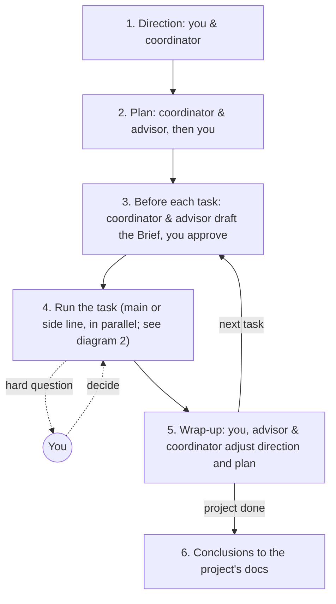
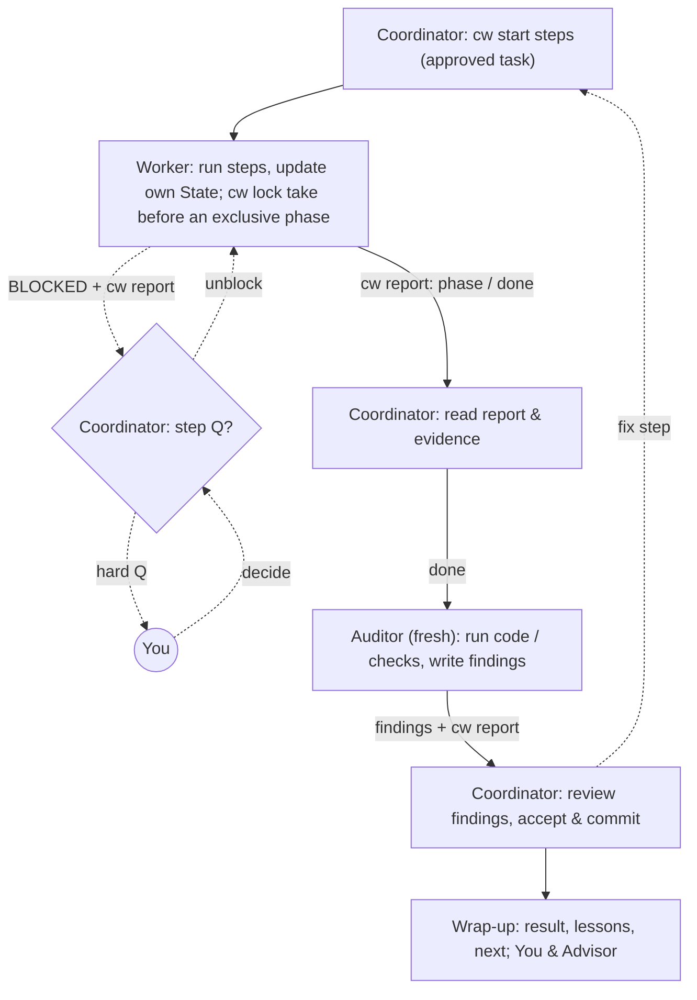

English | [中文](README.zh.md)

# agent-co-work

A portable multi-agent collaboration kit for any project folder on Unix-like hosts (macOS/Linux), built on Herdr (`hc`) and one standard-library Python CLI (`cw`).
You discuss direction with a coordinator, approve each task, decide hard questions, and review results with an advisor and coordinator.
Any seat can run any supported agent CLI (`claude`, `codex`, `agy`); the three-agent setup is only an example, and the authoritative rules live in [skill cowork](skills/cowork/SKILL.md#task-loop).

## Concepts

- **Project**: a long effort in `cowork/projects/<name>.md` (`status: active|closed`, with `Direction`, `Plan`, `Resources`, `Decisions`), owned by the coordinator. Standalone tasks work without a project.
- **Task (`kind: task`)**: a unit ending in a user decision, running on the `main` or `side` line (or `-`). Every task needs user approval before launch, and multiple approved tasks can run in parallel.
- **Step (`kind: step`)**: work inside a task (review, implementation, audit, fix, check), tracked in the task's `State` or in a separate step file with `parent: <task>`. Coordinator sessions use `kind: seat`.
- **Seats**: named roles in `cowork/seats.tsv` (`coordinator`, `coordinator-alt`, `advisor`, `coder-heavy`, `coder-light`, `auditor`) mapping each role to a supported agent CLI, model, effort, lifetime (`short` child terminal vs `long` parentless terminal), and optional quoted extra CLI `args`.
- **`cowork/` files**: `cowork/cw` (vendored standalone CLI), `seats.tsv` (seat table), `coordinator.addr` (active coordinator terminal ID), `README.md` (generated overview), `projects/<name>.md`, daily task records `yyyymmdd/<task>.md` whose paths never move, `locks/<resource>`, and `lessons/`.

## Requirements

- **Host OS (macOS / Linux / POSIX)**: `bin/cw` unconditionally imports `fcntl` and serializes resource locks with `fcntl.flock`; native Windows Python is not supported.
- **Python 3.9+**: standard library only; `bin/cw` has no third-party dependencies.
- **Herdr (`hc` 0.1.22+)**: required for live launches, approvals, status, reports, and handover; optional for offline record management and command previews.
- **Agent CLIs (`claude`, `codex`, `agy`)**: install only the CLI(s) assigned in your `cowork/seats.tsv` or per-task overrides. None is required individually—a Claude-only setup needs only `claude` on `PATH`.
- **`git` (optional)**: required only when creating isolated checkouts with `cw new --worktree`.

## First deployment

1. Open the target project folder in a Herdr tab so `HC_TERMINAL_ID` and the tab's `herdr.space` label are set.
2. Start Claude Code (or your chosen coordinator CLI) in that tab.
3. Run the `cowork-init` flow—tell the coordinator *"Use agent-co-work from `<path to this repo>` to set up collaboration here"*, or run `python3 <kit-repo>/bin/cw init` from the target project root to print the default seat table and file plan (`create`, `append`, `unchanged`) without writing files.
4. Confirm the seat table; to override seats before installation, pass `--seat <seat>=<agent>:<model>:<effort>:<life>` (repeatable) and re-check the plan, then rerun that exact command with `--apply`.
5. Verify the installation with `cowork/cw seats` and `cowork/cw lint` (`Caps OK.`).

**What `init` touches:** creates `cowork/cw`, `cowork/seats.tsv`, `cowork/coordinator.addr`, `cowork/<today>/coordinator.md`, `cowork/README.md`, and `cowork/lessons/README.md`; copies the four skills (`cowork`, `cowork-init`, `cowork-seat`, `cowork-consolidate`) into `.claude/skills/` and `.agents/skills/`; appends `.worktrees/` to `.gitignore` if absent, appends a marked block to `AGENTS.md`, and adds `@AGENTS.md` to `CLAUDE.md` if absent. Existing content is never rewritten, rerunning prints `nothing to do`, and `python3 <kit-repo>/bin/cw init --upgrade` (then `--upgrade --apply`) refreshes only `cowork/cw`, the copied skills, and the marked `AGENTS.md` block.

### Using the Herdr app

Herdr shows spaces, tabs, and panes while `herdr-core` (`hc`) runs their terminals and keeps them alive when the window closes (closing a pane, tab, or space ends the terminals in it).

1. Open the Herdr app and create a space or tab in the target project folder from the app (the command palette `app.palette` lists every command by name with its key, including `space.new` and `tab.new`, and `app.help` toggles the keys dialog; with no space open, a new tab starts a space).
2. In that terminal, start Claude Code with `claude -n yyyymmdd-coordinator` (or your chosen coordinator CLI), then continue with `cowork-init` from step 3 above.
3. When launching seats, `cowork/cw start` passes the caller's `herdr.space=<id>` label to `hc run` without `herdr.tab`, so Herdr creates a new tab for each seat in the same space.

## Choosing seats

The default three-agent table in `templates/seats.tsv` is only an example. Any seat may use any supported adapter (`claude`, `codex`, `agy`) and any model/effort accepted by that CLI. An optional quoted sixth column `args` (`-` or absent means none) supplies extra adapter CLI options, split with shell-style quoting (inner quotes preserve spaces, no shell expansion) and appended verbatim to the adapter argv.

**Claude Code only** (only `claude` required):

| seat | agent | model | effort | life | [args] |
|---|---|---|---|---|---|
| `coordinator` | `claude` | `claude-opus-5-5` | `high` | `long` | `-` |
| `coordinator-alt` | `claude` | `claude-opus-5-5` | `high` | `long` | `-` |
| `advisor` | `claude` | `claude-opus-5-5` | `high` | `short` | `-` |
| `coder-heavy` | `claude` | `claude-opus-5-5` | `high` | `long` | `-` |
| `coder-light` | `claude` | `claude-opus-5-5` | `high` | `long` | `-` |
| `auditor` | `claude` | `claude-opus-5-5` | `high` | `long` | `-` |

**Claude Code + Codex** (`claude` and `codex` required):

| seat | agent | model | effort | life | [args] |
|---|---|---|---|---|---|
| `coordinator` | `claude` | `claude-opus-5-5` | `high` | `long` | `-` |
| `coordinator-alt` | `claude` | `claude-opus-5-5` | `high` | `long` | `-` |
| `advisor` | `claude` | `claude-opus-5-5` | `high` | `short` | `-` |
| `coder-heavy` | `codex` | `gpt-6-astra` | `high` | `long` | `-` |
| `coder-light` | `codex` | `gpt-6.1-sol` | `max` | `long` | `-` |
| `auditor` | `codex` | `gpt-6-astra` | `high` | `long` | `-` |

**Claude Code + agy + Codex** (shipped default in `templates/seats.tsv`):

| seat | agent | model | effort | life | [args] |
|---|---|---|---|---|---|
| `coordinator` | `claude` | `claude-opus-5-5` | `high` | `long` | `-` |
| `coordinator-alt` | `agy` | `gemini-4-neon-xhigh` | `xhigh` | `long` | `-` |
| `advisor` | `agy` | `gemini-4-neon-xhigh` | `xhigh` | `short` | `-` |
| `coder-heavy` | `codex` | `gpt-6-astra` | `high` | `long` | `-` |
| `coder-light` | `codex` | `gpt-6.1-sol` | `max` | `long` | `-` |
| `auditor` | `codex` | `gpt-6-astra` | `high` | `long` | `-` |

- **Change a seat default**: during init pass `--seat <seat>=<agent>:<model>:<effort>:<life>` (configure `args` afterward); afterward run `cowork/cw seat set [--args='...'] <seat> <agent> <model> <effort> [short|long]` (updates `cowork/seats.tsv`, keeps comments, and appends a `State` line to the caller's record). `--args='...'` replaces extra adapter options (e.g. `--args='--sandbox workspace-write'` or `'--config "label=two words"'`), omitting `--args` preserves existing `args`, and `--args=-` clears them; clear or replace incompatible options when switching adapters.
- **Name an agent for one task**: pass `--agent <agent>:<model>:<effort>[:<life>]` to `cowork/cw new`, or run `cowork/cw set <taskfile> agent=<agent>:<model>:<effort>[:<life>]` (`agent=-` restores the seat default). Omitted `life` inherits the seat, and task overrides retain the seat's `args` (so switching adapters on a seat with adapter-specific `args` requires clearing or updating those `args` first); the seat keeps its role and naming rules.

## How it runs

- **Direction and Plan**: you and the coordinator agree `Direction`; coordinator and advisor negotiate numbered tasks in `Plan`, and user approval is recorded in `Decisions`.
- **Per-task approval**: before each task runs, coordinator and advisor draft its `Brief` and record your approval (`approved: user, yyyy-mm-dd`, `status: approved`); no automatic continuation occurs without approval.
- **Parallel lines and hard questions**: multiple approved tasks can run concurrently on `main` or `side` lines; step-level questions stay with the coordinator, while hard questions (science, scope, budget, risk, failed gates) go to you first.
- **Wrap-up and closure**: after each task, advisor and coordinator negotiate results, lessons, and next work with you to adjust `Direction`/`Plan`; when the project closes, durable conclusions move to the project's own docs.

- **Launch gate**: `cw start` blocks unapproved tasks and worker steps whose parent task is not approved (`approved`, `running`, or `blocked`); advisor steps, parentless steps, and `kind: seat` records bypass that gate.
- **Work and reporting**: each worker writes only its own `State` (using `--worktree` when two or more coders edit the same repo concurrently) and runs `cw report "<conclusion>; <path>"` only at stop conditions (`BLOCKED: <reason>`), named phase transitions, or completion; `cw report --to <task>` sends to a live task terminal and copies the coordinator.
- **Failure classes**: unexpected failures stop and report state-changing work (launches, shared environments, deleting or moving data); re-runnable work (tests, analysis, scratch outputs) fixes its own code and continues, stopping only at a decision gate, a frozen value, a shared dependency, or a budget limit.
- **Execution context**: never infer missing hardware or services from a sandbox error; recheck in the intended execution context and record where the probe ran.
- **Fresh audit**: an independent, fresh-session `auditor` runs code/checks, verifies advisor facts before user decisions, and writes findings to a file.
- **Acceptance and commits**: coders and auditors never stage or commit; the coordinator accepts from the audit findings and commits (merging worktrees when used).
- **Worker Git limits**: workers never run `git reset --hard`, `git checkout -- .`, `git restore .`, `git clean`, or `git push --force`.
- **Authoritative rules**: see [skill cowork](skills/cowork/SKILL.md#task-loop) for the complete collaboration rules.

## Resources and locks

- List only exclusive resources in the project's `## Resources` section (`<name>: <description>`), separating distinct exclusive phases (such as `training-code` and `gpu`). Resource locks never gate `cw start`, so CPU prep can run while another task holds a GPU lock.
- **Queue and acquire**: the coordinator sets or clears the single queue head with `cowork/cw lock next <resource> <task|->`; the worker runs fresh host/resource checks, then runs `cowork/cw lock take <resource>` immediately before the exclusive phase.
- **Advisory estimate**: the holder may call `cowork/cw lock expect <resource> <time>` to notify the successor and coordinator (`estimate != release`; never permits early launch; writes no `State` line).
- **Release and stale recovery**: the holder calls `cowork/cw lock release <resource> [--evidence <path>] [--note <text>]`, freeing the lock before sending notifications, preserving the queue head, and adding one `State` line. `cowork/cw status` flags closed, missing, or exited holders with `! stale holder` (never auto-released); only a coordinator seat may recover one with `--force`.
- **Storage**: extensionless TSV files at `cowork/locks/<resource>` storing `yyyymmdd/<task>` identities, serialized with `fcntl.flock` on `cowork/locks/.flock` and shared across worktrees through `COWORK_ROOT`.

## Records, Wrap-up, and lessons

- Daily records live at `cowork/yyyymmdd/<task>.md` and are never moved; each seat writes only its own file and edits frontmatter only through `cowork/cw set`. Task, project, and resource names match `[a-z0-9]([a-z0-9-]{0,18}[a-z0-9])?`; terminal names are `yyyymmdd-<task>` (with `-2`..`-9` collision suffixes).
- **Phase records**: each Brief names phase transitions; record resource release, data return, and task closure separately in `State`, each with time and an evidence path. Archiving remains separate.
- **Evidence and corrections**: never rewrite, rename, or delete executed outputs, logs, or receipts; append `CORRECTION <date>: <what>; <evidence>; supersedes <line>` to a wrong record, and redo a wrong output as a newly named run, recording which run supersedes which.
- **Conclusions and acceptance**: edit conclusions and docs directly with a dated line in the Wrap-up or project `Decisions`; never rerun passed acceptance, and correct wrong acceptance with an appended line. Monitoring metrics used for training or selection are never independent acceptance.
- Finish each task with a `## Wrap-up`: result, where, 1–3 `- lesson:` lines, proposed next, and user decision (recorded only when received). Legacy `size:` headers and `debrief` / `## Debrief` records remain readable.
- `cowork/cw index` regenerates `cowork/README.md` (active tasks grouped by project and line, plus closed tasks from the last 7 days, <=60 lines).
- `cowork/cw lessons [yyyymmdd]` refreshes `From tasks` in `cowork/lessons/<date>.md` from Wrap-up and legacy Debrief lessons without overwriting `Takeaways`; run `cowork-consolidate` weekly or when `cowork/lessons/README.md` exceeds its cap.
- `cowork/cw lint` checks caps (`Goal` <=3, `State` <=10, `Handover` <=20, `lessons/README.md` <=40, `cowork/README.md` <=60), validates project status and task headers/names, and lists exact duplicate lines longer than 40 characters.

## Coordinator handover

- Trigger handover around 60% context use, after a Wrap-up, or at end of day after recording recovery context in the outgoing coordinator's `## Handover` section.
- Run `cowork/cw handover context` to launch a fresh `coordinator`, or `cowork/cw handover tokens` to switch to `coordinator-alt` (and back the same way).
- The successor launches with `--no-parent` in the caller's Herdr space, reads the outgoing record, `cowork/README.md`, `cowork/projects/`, and active task records, then runs `cowork/cw handover --accept`.
- `--accept` writes the successor's terminal ID to `cowork/coordinator.addr`, sends acceptance to the previous coordinator, and logs delivery in its own `State`; the outgoing `cw handover` polls `coordinator.addr` to confirm takeover.

## Without Herdr

- Without `HC_TERMINAL_ID`, `cw init --apply` sets `cowork/coordinator.addr` to `- -`; record commands (`project new`, `new`, `set`, `seat set`, `index`, `lessons`, `lint`, and lock state changes) work offline.
- `cowork/cw start <taskfile>` (or `--print` anytime) prints the exact `hc` launch commands without launching or editing records; `cowork/cw check <taskfile>` prints the `hc get` command plus the last 3 `State` lines.
- `cowork/cw status` lists only non-closed tasks with an assigned terminal (skipping closed tasks and `terminal: -`), reporting `Herdr unavailable` while still flagging `BLOCKED:` in their `State`, plus closed or missing stale lock holders.
- `cowork/cw report` appends `REPORT (undelivered): ...` to `State`, prints a `Relay to coordinator:` line for manual relay, and exits 1; `cowork/cw handover` requires `HC_TERMINAL_ID`.

Long seats launch with `--no-parent`; short seats explicitly use `--parent <caller t-id>`. Both retain the caller's `herdr.space` label. Since hc does not send blocked/exit notes for parentless seats to the coordinator, the coordinator runs `cw status` whenever a report arrives and at each scheduled check.

## Troubleshooting

- **Wrong terminal identity after resuming Claude Code**: a resumed session may run tools with another session's `HC_TERMINAL_ID`. Check `echo $HC_TERMINAL_ID` against `cowork/coordinator.addr`; if you are the recorded coordinator, pin the correct value, for example `HC_TERMINAL_ID=t22 cowork/cw start <taskfile>`. Callers without `COWORK_TASK` are checked before `start`, `lock next`, coordinator `lock take` / `release --force`, `handover context|tokens`, and `seat set`. Seat callers, `handover --accept`, `report`, and operation without Herdr are unaffected.

- **Trust and permission prompts**: `cw start` and `cw handover` invoke `cw approve` only for (a) a folder-trust prompt matching the exact project root, or (b) an `agy` permission prompt for a plain `cowork/cw ...` command (choosing "always allow in this conversation"). Any other or repeated unmatched prompt exits 2 with the screen tail without pressing keys; inspect with `hc read <t> --lines 0` and answer manually, or run `cowork/cw approve <t>` on a recognized prompt.
- **Codex start exits with an account error**: if Codex (or another agent) exits early while its task is known to be undelivered (for example, an account or routing error on startup), `cw start` reads and prints the screen tail, removes that failed terminal record, and relaunches once with the same name under the original 120 s startup deadline. A second early exit (or cleanup failure) prints the screen tail and stops without updating the task header; inspect the printed tail (and `hc read <name> --lines 0` if the second terminal remains), check Codex login/account status, and rerun `cowork/cw start <taskfile>`. Delivered or ambiguous task deliveries are never relaunched, and `cw handover` does not auto-relaunch.
- **Nested projects asking about external `CLAUDE.md` imports**: `cw init` adds `@AGENTS.md` to `CLAUDE.md`. In a nested project where Claude Code asks whether to allow external `CLAUDE.md` imports, `cw approve` intentionally refuses to press keys (exits 2 with the screen tail) because it is not a recognized root folder-trust prompt; confirm or decline the dialog manually in Herdr.
- **agy status lag**: Herdr can report `agy` as `done` before generation finishes. Wait for the seat's `cw report` message rather than terminal status alone, and check progress with `cowork/cw check <taskfile>`.

## Command reference

All <code>cw</code> commands (global flag: <code>--root &lt;dir&gt;</code>)

| Command | Purpose |
|---|---|
| `cw init [--seat seat=agent:model:effort:life] [--upgrade] [--apply]` | Plan, apply, or upgrade a project installation |
| `cw seats` | Print `cowork/seats.tsv` |
| `cw seat set [--args='...'] <seat> <agent> <model> <effort> [life]` | Update one seat row (omit `--args` to preserve; `--args=-` clears) and append a `State` entry |
| `cw project new <name>` | Create `cowork/projects/<name>.md` |
| `cw new <task> --seat <seat> (--kind task\|step \| --size large\|small) [--project <name>] [--line main\|side\|-] [--parent <task>] [--agent agent:model:effort[:life]] [--worktree]` | Create `cowork/<today>/<task>.md` (and optional `.worktrees/<task>`) |
| `cw set <taskfile> key=value ...` | Edit validated task frontmatter fields |
| `cw start <taskfile> [--print]` | Launch a gated task/step in Herdr, or print launch commands |
| `cw check <taskfile>` | Show terminal `hc get` status and last 3 `State` lines |
| `cw approve <terminal>` | Answer a recognized root trust or `agy` `cowork/cw` prompt (exit 2 otherwise) |
| `cw status` | List non-closed tasks with assigned terminals (`blocked`, `error`, `exited`, `BLOCKED:`) and locks (`! stale holder`) |
| `cw lock next <resource> <task\|->` | Coordinator sets or clears the single queue head |
| `cw lock take <resource>` | Acquire an available or queued lock for the caller task |
| `cw lock expect <resource> <time>` | Send an advisory release estimate to successor and coordinator |
| `cw lock release <resource> [--evidence <path>] [--note <text>] [--force]` | Release lock, notify successor/coordinator, write one `State` line (`--force`: coordinator only) |
| `cw report [--to <task>] "<conclusion>; <path>"` | Report to coordinator (and optionally a live task terminal) |
| `cw handover [context\|tokens \| --accept]` | Launch a successor coordinator or accept `coordinator.addr` |
| `cw index` | Regenerate `cowork/README.md` |
| `cw lessons [yyyymmdd]` | Collect Wrap-up/Debrief `- lesson:` lines into `cowork/lessons/<date>.md` |
| `cw lint` | Check record caps, project/task validation, and duplicate lines |

## Known limits

- **Fixed adapter set**: built-in launch and approval adapters support `claude`, `codex`, and `agy`; unknown agents error.
- **Narrow auto-approval**: `cw approve` presses keys only on exact-root trust prompts and single-command `agy` `cowork/cw` prompts; all other dialogs stop (exit 2) for a human decision.
- **No cryptographic enforcement**: `approved: user, yyyy-mm-dd` and seat roles are validated for format/date, not enforced as a security boundary against manual edits.
- **Bounded startup retry and manual recovery**: `cw start` relaunches at most once on a confirmed early exit while the task is known to be undelivered (same name, original 120 s startup deadline); a second exit, any delivered or ambiguous task send, any `cw handover` exit, and deadline expiry stop for inspection. Stale locks are flagged (`! stale holder`) and never auto-released.
- **Naming and visibility caps**: names are 1–20 chars (`[a-z0-9]([a-z0-9-]{0,18}[a-z0-9])?`), collision suffixes stop at `-9`, and callers without a `herdr.space` label launch hidden terminals with a warning.
- **Unit test scope**: `tests/` uses isolated fake `hc`/`git` binaries, captured prompt screens, and real competing lock processes; live multi-agent handover is not automated in the suite.

## Development

- **Layout**: `bin/cw` (single stdlib Python 3 script), `skills/` (`cowork`, `cowork-init`, `cowork-seat`, `cowork-consolidate`), `templates/`, and `tests/`.
- **Single source of rules**: collaboration rules live only in [skills/cowork/SKILL.md](skills/cowork/SKILL.md) (cap 150 lines); the other three skills link to it without restating rules.
- **Checks**: run `python3 -m unittest discover tests` in the kit checkout. Run `cowork/cw lint` in an initialized project to check its collaboration records.
