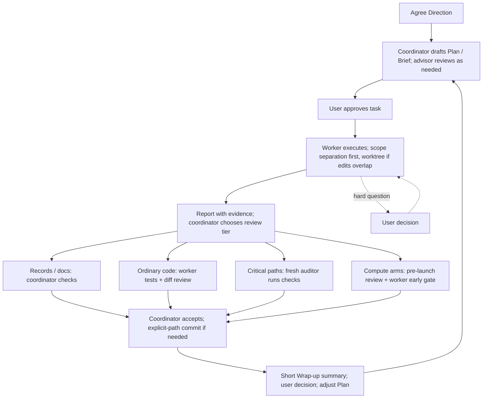

English | [中文](README.zh.md)

# agent-co-work

A portable multi-agent collaboration kit for any project folder on Unix-like hosts (macOS/Linux), built on Herdr (`hc`) and one standard-library Python CLI (`cw`).
You discuss direction with a coordinator, approve each task, decide hard questions, and review the coordinator’s conclusion-first summaries; an advisor supplies reviews when needed.
Any seat can run any supported agent CLI (`claude`, `codex`, `agy`); the three-agent setup is only an example, and the authoritative rules live in [skill cowork](skills/cowork/SKILL.md#task-loop).

## Quick start

Prerequisites: macOS/Linux, Python 3.9+, `git` with GitHub SSH access, the Herdr app with `hc` 0.1.22+, and at least one of `claude`, `codex`, or `agy` (see [Requirements](#requirements) and [Using the Herdr app](#using-the-herdr-app)).

1. **Once per machine**, clone the release into its fixed location:

   ```sh
   git clone git@github.com:YitaoXU/agent-co-work.git ~/.agent-co-work
   ```

2. **New project**: open its root in a Herdr app tab, start your coordinator there (e.g. `claude -n yyyymmdd-coordinator`), and paste the [coordinator prompt](#coordinator-prompt) below. To install by hand, run from the project root in that same tab:

   ```sh
   git -C ~/.agent-co-work pull --ff-only
   python3 ~/.agent-co-work/bin/cw init
   ```

   Review the seat table, file plan and kit version, then apply:

   ```sh
   python3 ~/.agent-co-work/bin/cw init --apply
   cowork/cw lint
   ```

3. **Upgrade**: from the existing project's root in its coordinator's Herdr tab, update the release and inspect the upgrade plan:

   ```sh
   git -C ~/.agent-co-work pull --ff-only
   python3 ~/.agent-co-work/bin/cw init --upgrade
   ```

   Confirm the plan, then apply:

   ```sh
   python3 ~/.agent-co-work/bin/cw init --upgrade --apply
   cowork/cw lint
   ```

### Coordinator prompt

```text
Set up or upgrade agent-co-work in this project. If ~/.agent-co-work is missing,
clone git@github.com:YitaoXU/agent-co-work.git into ~/.agent-co-work; otherwise run
git -C ~/.agent-co-work pull --ff-only. Read
~/.agent-co-work/skills/cowork-init/SKILL.md. For a fresh installation, run
python3 ~/.agent-co-work/bin/cw init; for an existing installation, run
python3 ~/.agent-co-work/bin/cw init --upgrade. Show me the seat table, file plan
and kit version. Apply the same command with --apply only after my confirmation,
then run cowork/cw lint.
```

## Concepts

- **Project**: a long effort in `cowork/projects/<name>.md` (`status: active|closed`, with `Direction`, `Plan`, `Resources`, `Decisions`), owned by the coordinator. Standalone tasks work without a project.
- **Task (`kind: task`)**: a unit ending in a user decision, running on the `main` or `side` line (or `-`). Every task needs user approval before launch, and multiple approved tasks can run in parallel.
- **Step (`kind: step`)**: work inside a task (review, implementation, audit, fix, check), tracked in the task's `State` or in a separate step file with `parent: <task>`. Coordinator sessions use `kind: seat`.
- **Seats**: named roles in `cowork/seats.tsv` (`coordinator`, `coordinator-alt`, `advisor`, `coder-heavy`, `coder-light`, `auditor`) mapping each role to a supported agent CLI, model, effort, lifetime (`short` child terminal vs `long` parentless terminal), and optional quoted extra CLI `args`.
- **`cowork/` files**: `cowork/cw` (vendored standalone CLI), `kit-version` (installed kit commit and origin), `seats.tsv` (seat table), `coordinator.addr` (active coordinator terminal ID), `README.md` (generated overview), `projects/<name>.md`, daily task records `yyyymmdd/<task>.md` whose paths never move, `locks/<resource>`, and `lessons/`.

## Requirements

- **Host OS (macOS / Linux / POSIX)**: `bin/cw` unconditionally imports `fcntl` and serializes resource locks with `fcntl.flock`; native Windows Python is not supported.
- **Python 3.9+**: standard library only; `bin/cw` has no third-party dependencies.
- **Herdr (`hc` 0.1.22+)**: required for live launches, approvals, status, reports, and handover; optional for offline record management and command previews.
- **Agent CLIs (`claude`, `codex`, `agy`)**: install only the CLI(s) assigned in your `cowork/seats.tsv` or per-task overrides. None is required individually—a Claude-only setup needs only `claude` on `PATH`.
- **`git`**: required to clone and update the GitHub release, identify its version, and create isolated checkouts with `cw new --worktree`. Installed record commands work without it.

## Installation details

The release clone at `~/.agent-co-work` is shared by all target projects. Always run installation and upgrade commands through `python3 ~/.agent-co-work/bin/cw`, so they use the release's current skills and templates.

**Seats:** choose the CLI(s) you have installed from [Choosing seats](#choosing-seats), including the single-CLI example. Before a fresh install, pass `--seat <seat>=<agent>:<model>:<effort>:<life>` to `init` (repeatable) to override defaults, review the revised plan, then rerun that exact command with `--apply`. Run `cowork/cw seats` to inspect the installed table.

**Kit version:** the plan shows `kit: to <sha>` on a fresh install or `kit: from <old|unknown> to <sha>` for a changed upgrade. A fresh install or upgrade writes `cowork/kit-version` as one line containing the clone's full HEAD commit and origin URL (HTTPS credentials are removed). `cowork/cw lint` prints the installed version and `Caps OK.`; compare the version with the plan. An unchanged version prints no version-change line. Plain `init` preserves an older project's version, including a missing stamp; use `--upgrade` to record the installed release. Check warnings about uncommitted kit changes or a development checkout before deploying.

**What `init` touches:** creates `cowork/cw`, `cowork/kit-version` (fresh install only), `cowork/seats.tsv`, `cowork/coordinator.addr`, `cowork/<today>/coordinator.md`, `cowork/README.md`, and `cowork/lessons/README.md`; copies the four skills (`cowork`, `cowork-init`, `cowork-seat`, `cowork-consolidate`) into `.claude/skills/` and `.agents/skills/`; on fresh installation appends missing `cowork/`, `output/`, `.scratch/`, `.tmp/`, and `.worktrees/` entries to `.gitignore` (listed in the plan), appends a marked block to `AGENTS.md`, and adds `@AGENTS.md` to `CLAUDE.md` if absent. After installation, plain init and `--upgrade` preserve `.gitignore` byte-for-byte and print a note if default entries are missing. Plain init preserves other existing content, and rerunning an up-to-date installation prints `nothing to do`. `python3 ~/.agent-co-work/bin/cw init --upgrade` (then `--upgrade --apply`) refreshes only `cowork/cw`, `cowork/kit-version`, the copied skills, and the marked `AGENTS.md` block.

### Using the Herdr app

Herdr shows spaces, tabs, and panes while `herdr-core` (`hc`) runs their terminals and keeps them alive when the window closes (closing a pane, tab, or space ends the terminals in it).

1. Open the Herdr app and create a space or tab in the target project folder from the app (the command palette `app.palette` lists every command by name with its key, including `space.new` and `tab.new`, and `app.help` toggles the keys dialog; with no space open, a new tab starts a space).
2. In that terminal, start Claude Code with `claude -n yyyymmdd-coordinator` (or your chosen coordinator CLI), then paste the [coordinator prompt](#coordinator-prompt) from Quick start.
3. When launching seats, `cowork/cw start` passes the caller's `herdr.space=<id>` label to `hc run` without `herdr.tab`, so Herdr creates a new tab for each seat in the same space. Long seats use `--no-parent`; short seats use `--parent <caller t-id>`.

## Choosing seats

The default three-agent table in `templates/seats.tsv` is only an example. Any seat may use any supported adapter (`claude`, `codex`, `agy`) and any model/effort accepted by that CLI. An optional quoted sixth column `args` (`-` or absent means none) supplies extra adapter CLI options, split with shell-style quoting (inner quotes preserve spaces, no shell expansion) and appended verbatim to the adapter argv.

Each cell lists `agent model effort life`; optional `args` are described above.

| seat | Claude Code only | Claude Code + Codex | Claude Code + agy + Codex (shipped default) |
|---|---|---|---|
| `coordinator` | `claude claude-opus-5-5 high long` | `claude claude-opus-5-5 high long` | `claude claude-opus-5-5 high long` |
| `coordinator-alt` | `claude claude-opus-5-5 high long` | `claude claude-opus-5-5 high long` | `agy gemini-4-neon-xhigh xhigh long` |
| `advisor` | `claude claude-opus-5-5 high short` | `claude claude-opus-5-5 high short` | `agy gemini-4-neon-xhigh xhigh short` |
| `coder-heavy` | `claude claude-opus-5-5 high long` | `codex gpt-6-astra high long` | `codex gpt-6-astra high long` |
| `coder-light` | `claude claude-opus-5-5 high long` | `codex gpt-6.1-sol max long` | `codex gpt-6.1-sol max long` |
| `auditor` | `claude claude-opus-5-5 high long` | `codex gpt-6-astra high long` | `codex gpt-6-astra high long` |

- **Change a seat default**: during init pass `--seat <seat>=<agent>:<model>:<effort>:<life>` (configure `args` afterward); afterward run `cowork/cw seat set [--args='...'] <seat> <agent> <model> <effort> [short|long]` (updates `cowork/seats.tsv`, keeps comments, and appends a `State` line to the caller's record). `--args='...'` replaces extra adapter options (e.g. `--args='--sandbox workspace-write'` or `'--config "label=two words"'`), omitting `--args` preserves existing `args`, and `--args=-` clears them; clear or replace incompatible options when switching adapters.
- **Name an agent for one task**: pass `--agent <agent>:<model>:<effort>[:<life>]` to `cowork/cw new`, or run `cowork/cw set <taskfile> agent=<agent>:<model>:<effort>[:<life>]` (`agent=-` restores the seat default). Omitted `life` inherits the seat, and task overrides retain the seat's `args` (so switching adapters on a seat with adapter-specific `args` requires clearing or updating those `args` first); the seat keeps its role and naming rules.

- **Extra arguments for one task**: `cw new ... --args='-a never'` or `cw set <taskfile> 'args=-a never'` appends task options after seat options for every adapter. `args=-` clears only the task options; legacy headers without `args:` mean none. Values use shell-style quoting without shell expansion; `args: --label "run # 1" # comment` preserves the quoted hash. Keep unattended-run options on the task that needs them.

## Default project layout

Projects can declare a "where things go" override in `AGENTS.md`; installation does not relocate existing files. Ignored evidence is local and needs the project's own backup policy.

| Path | Contents | Fresh-install tracking | Durable evidence |
|---|---|---|---|
| `docs/` | Living guides, designs, accepted conclusions | Tracked | Yes |
| `docs/archive/` | Dated rollups of superseded prose | Tracked | Yes |
| `cowork/` | Daily records, projects, seats, locks, lessons | Ignored | Yes, local records |
| `output/<yyyymmdd>/<task>/` | Results, audit findings, logs, rolled-up `log.md` | Ignored | Yes; protect cited paths |
| `.scratch/` | Host-local operational receipts and scheduler files | Ignored | Operational receipts only |
| `.tmp/` | Disposable clones, sandboxes, probes | Ignored | No; export needed evidence first |
| `.worktrees/` | Optional isolated checkouts | Ignored | No; retire after merge/closure |

See [consolidation](skills/cowork-consolidate/SKILL.md) for each class's lifecycle, cap, and archive destination.

## How it runs



`cw start` enforces the task/parent approval gate; `cw new --worktree` creates `.worktrees/<task>` and a task branch, with records kept in the main checkout through `COWORK_ROOT`; see the skill's [review and Git rules](skills/cowork/SKILL.md#escalation-and-review).

## Resources and locks

- **Advisory estimate**: `cowork/cw lock expect <resource> <time>` notifies the successor and coordinator and writes no `State` line.
- **Release and stale recovery**: the holder calls `cowork/cw lock release <resource> [--evidence <path>] [--note <text>]`, freeing the lock before sending notifications, preserving the queue head, and adding one `State` line. `cowork/cw status` flags closed, missing, or exited holders with `! stale holder` (never auto-released); only a coordinator seat may recover one with `--force --holder <yyyymmdd/task>`. The expected holder is validated and compared under the lock; missing, malformed, or mismatched holders exit 1 without changing the lock.
- **Storage**: extensionless TSV files at `cowork/locks/<resource>` storing `yyyymmdd/<task>` identities, serialized with `fcntl.flock` on `cowork/locks/.flock` and shared across worktrees through `COWORK_ROOT`.

Lock commands return 1 for a pre-mutation error and 3 for a mutation followed by a notification or receipt-write failure (including `expect`). After 3 or an ambiguous error, inspect `cw status` and the holder/since fields before retrying. `--holder` protects a different task's acquisition, but cannot distinguish a later acquisition by the same task. See the [resource rules](skills/cowork/SKILL.md#resources).

## Records, Wrap-up, and lessons

The [record rules](skills/cowork/SKILL.md#records-and-messages) specify ownership and immutable evidence; [cowork-consolidate](skills/cowork-consolidate/SKILL.md) covers rolling State, Decisions/Plan, lessons, overview/handover, archives, outputs/scratch, and memory.

- `cw report "<conclusion>; <path>"` sends a task-prefixed message to the coordinator. `--to <task>` resolves the sender's day first, otherwise the newest matching record, sends to its live terminal, and copies the coordinator; an absent target falls back to coordinator only. Each direct destination gets a delivery receipt.
- Report sends allow up to three attempts of about 180 seconds each, within one shared 10-minute budget for the whole command (including both destinations with `--to`). Before a retry, the target screen is read; a visible payload counts as delivered without resending. Progress goes to stderr; only the final outcome creates a receipt. Task delivery, keys, launches, and other notifications retain their existing behavior.
- Failed coordinator reports append `REPORT (undelivered):`; a later exact payload/destination match appends `REPORT (delivered):` without deleting the failure. Ordinary first-try coordinator deliveries add no State line. `cw status` flags unresolved receipts, including closed or unassigned tasks; different payloads/destinations stay separate and a later failure reopens the flag.
- `cw index` regenerates the <=60-line overview with active tasks/seats grouped by project/line and those closed in the last 7 days. Steps are folded into counts on their parent task lines (same-day parent first, otherwise newest); standalone steps remain in daily records. Overflow fails without replacing the overview.
- `cw lessons [yyyymmdd]` refreshes daily From tasks from Wrap-up/legacy Debrief lessons and preserves Takeaways.
- `cw lint` prints the installed kit version, validates headers/project status, and checks nonempty section lines: Goal <=3, State <=10, Handover <=20, project Decisions <=20. File caps are lessons README <=40 and overview <=60; archived project histories are excluded from Decisions checks. Exact duplicate lines longer than 40 characters are diagnostic.

Task templates include `args: -`; legacy `size:` and `debrief` / `## Debrief` remain readable. Use `cw set` to update frontmatter.

## Coordinator handover

- Run `cowork/cw handover context` to launch a fresh `coordinator`, `cowork/cw handover tokens` to switch to `coordinator-alt` (or back), or `cowork/cw handover --accept` to accept; see the [handover rules](skills/cowork/SKILL.md#size-limits-consolidation-and-handover).
- `--accept` writes the successor's terminal ID to `cowork/coordinator.addr`, sends acceptance to the previous coordinator, and logs delivery in its own `State`; the outgoing `cw handover` polls `coordinator.addr` to confirm takeover.

## Without Herdr

- Without `HC_TERMINAL_ID`, `cw init --apply` sets `cowork/coordinator.addr` to `- -`; record commands (`project new`, `new`, `set`, `seat set`, `index`, `lessons`, `lint`, and lock state changes) work offline.
- `cowork/cw start <taskfile>` (or `--print` anytime) prints the exact `hc` launch commands without launching or editing records; `cowork/cw check <taskfile>` prints the `hc get` command plus the last 3 `State` lines.
- `cowork/cw status` lists active assigned terminals plus any task with unresolved report receipts, reporting `Herdr unavailable` while still flagging `BLOCKED:` in their `State`, plus closed or missing stale lock holders.
- `cowork/cw report` appends `REPORT (undelivered): ...` to `State`, prints a `Relay to coordinator:` line for manual relay, and exits 1; `cowork/cw handover` requires `HC_TERMINAL_ID`.

## Troubleshooting

- **Wrong terminal identity after resuming Claude Code**: a resumed session may run tools with another session's `HC_TERMINAL_ID`. Check `echo $HC_TERMINAL_ID` against `cowork/coordinator.addr`; if you are the recorded coordinator, pin the correct value, for example `HC_TERMINAL_ID=t22 cowork/cw start <taskfile>`. Callers without `COWORK_TASK` are checked before `start`, `lock next`, coordinator `lock take` / `release --force`, `handover context|tokens`, and `seat set`. Seat callers, `handover --accept`, `report`, and operation without Herdr are unaffected.

- **Trust and permission prompts**: `cw start` and `cw handover` invoke `cw approve` only for (a) a folder-trust prompt matching the exact project root (or the task’s assigned worktree during `cw start`), or (b) an `agy` permission prompt for a plain `cowork/cw ...` command (choosing "always allow in this conversation"). Standalone `cw approve` stays root-only; sibling folders are not allowed. Any other or repeated unmatched prompt exits 2 with the screen tail without pressing keys; inspect with `hc read <t> --lines 0` and answer manually, or run `cowork/cw approve <t>` on a recognized prompt.
- **Codex start exits with an account error**: if Codex (or another agent) exits early while its task is known to be undelivered (for example, an account or routing error on startup), `cw start` reads and prints the screen tail, removes that failed terminal record, and relaunches once with the same name under the original 120 s startup deadline. A second early exit (or cleanup failure) prints the screen tail and stops without updating the task header; inspect the printed tail (and `hc read <name> --lines 0` if the second terminal remains), check Codex login/account status, and rerun `cowork/cw start <taskfile>`. Delivered or ambiguous task deliveries are never relaunched, and `cw handover` does not auto-relaunch.
- **Nested projects asking about external `CLAUDE.md` imports**: `cw init` adds `@AGENTS.md` to `CLAUDE.md`. In a nested project where Claude Code asks whether to allow external `CLAUDE.md` imports, `cw approve` intentionally refuses to press keys (exits 2 with the screen tail) because it is not a recognized root folder-trust prompt; confirm or decline the dialog manually in Herdr.
- **agy status lag**: Herdr can report `agy` as `done` before generation finishes. Wait for the seat's `cw report` message rather than terminal status alone, and check progress with `cowork/cw check <taskfile>`.

## Command reference

<details>
<summary>All <code>cw</code> commands (global flag: <code>--root &lt;dir&gt;</code>)</summary>

| Command | Purpose |
|---|---|
| `python3 ~/.agent-co-work/bin/cw init [--seat seat=agent:model:effort:life] [--upgrade] [--apply]` | Install or upgrade from the fixed GitHub release clone; plan the version and write `cowork/kit-version` on fresh install or upgrade |
| `cw seats` | Print `cowork/seats.tsv` |
| `cw seat set [--args='...'] <seat> <agent> <model> <effort> [life]` | Update one seat row (omit `--args` to preserve; `--args=-` clears) and append a `State` entry |
| `cw project new <name>` | Create `cowork/projects/<name>.md` |
| `cw new <task> --seat <seat> (--kind task\|step \| --size large\|small) [--project <name>] [--line main\|side\|-] [--parent <task>] [--agent agent:model:effort[:life]] [--args='...'] [--worktree]` | Create `cowork/<today>/<task>.md` (and optional `.worktrees/<task>`) |
| `cw set <taskfile> key=value ...` | Edit validated task frontmatter fields |
| `cw start <taskfile> [--print]` | Launch a gated task/step in Herdr, or print launch commands |
| `cw check <taskfile>` | Show terminal `hc get` status and last 3 `State` lines |
| `cw approve <terminal>` | Answer a recognized root trust or `agy` `cowork/cw` prompt (exit 2 otherwise) |
| `cw status` | List active assigned terminals and unresolved reports (`blocked`, `error`, `exited`, `BLOCKED:`, `undelivered report`) and locks (`! stale holder`) |
| `cw lock next <resource> <task\|->` | Coordinator sets or clears the single queue head |
| `cw lock take <resource>` | Acquire an available or queued lock for the caller task |
| `cw lock expect <resource> <time>` | Send an advisory release estimate to successor and coordinator |
| `cw lock release <resource> [--evidence <path>] [--note <text>] [--force --holder <yyyymmdd/task>]` | Release lock, notify successor/coordinator, write one `State` line (`--force --holder`: coordinator only; post-mutation failure exits 3) |
| `cw report [--to <task>] "<conclusion>; <path>"` | Report to coordinator (and optionally a live task terminal) |
| `cw handover [context\|tokens \| --accept]` | Launch a successor coordinator or accept `coordinator.addr` |
| `cw index` | Regenerate `cowork/README.md` |
| `cw lessons [yyyymmdd]` | Collect Wrap-up/Debrief `- lesson:` lines into `cowork/lessons/<date>.md` |
| `cw lint` | Print installed `cowork/kit-version`; check record caps, project/task validation, and duplicate lines |

</details>

## Known limits

- **Fixed adapter set**: built-in launch and approval adapters support `claude`, `codex`, and `agy`; unknown agents error.
- **Narrow auto-approval**: only recognized prompts are automated; see [Troubleshooting](#troubleshooting).
- **No cryptographic enforcement**: `approved: user, yyyy-mm-dd` and seat roles are validated for format/date, not enforced as a security boundary against manual edits.
- **Bounded startup retry and manual recovery**: see [Troubleshooting](#troubleshooting) for startup recovery; stale locks are flagged (`! stale holder`) and never auto-released.
- **Naming and visibility caps**: names are 1–20 chars (`[a-z0-9]([a-z0-9-]{0,18}[a-z0-9])?`), collision suffixes stop at `-9`, and callers without a `herdr.space` label launch hidden terminals with a warning.
- **Unit test scope**: `tests/` uses isolated fake `hc`/`git` binaries, local Git clone fixtures, captured prompt screens, and real competing lock processes; live multi-agent handover is not automated in the suite.

## Development

- **Layout**: `bin/cw` (single stdlib Python 3 script), `skills/` (`cowork`, `cowork-init`, `cowork-seat`, `cowork-consolidate`), `templates/`, and `tests/`.
- **Single source of rules**: collaboration rules live only in [skills/cowork/SKILL.md](skills/cowork/SKILL.md) (cap 150 lines); the other three skills link to it without restating rules.
- **Checks**: run `python3 -m unittest discover tests` in the kit checkout. Run `cowork/cw lint` in an initialized project to check its collaboration records.
