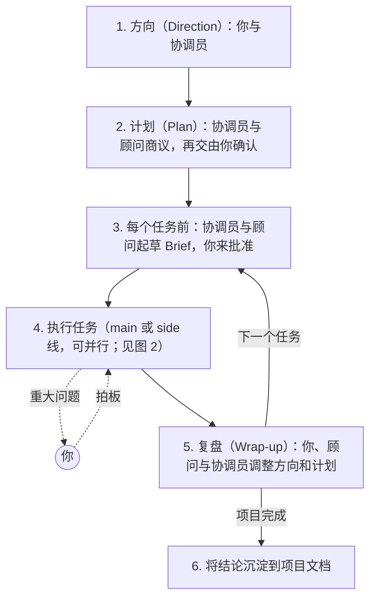
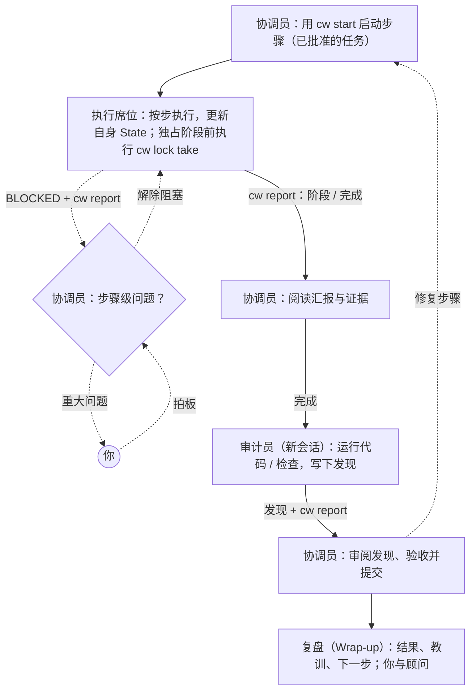

[English](README.md) | 中文

# agent-co-work

一套可移植的多智能体协作套件，适用于类 Unix 主机（macOS/Linux）上的任意项目目录，基于 Herdr（`hc`）与单个标准库 Python CLI（`cw`）构建。
你与协调员商定方向、批准每个任务、裁决重大问题，并与顾问及协调员共同复盘结果。
任意席位都可运行任意受支持的 agent CLI（`claude`、`codex`、`agy`）；三 agent 配置仅作示例，权威协作规则以 [cowork 技能](skills/cowork/SKILL.md#task-loop) 为准。

## 核心概念

- **项目（Project）**：记录在 `cowork/projects/<name>.md` 中的长期工作（`status: active|closed`，包含 `Direction`、`Plan`、`Resources`、`Decisions`），由协调员维护。独立任务可不关联项目。
- **任务（`kind: task`）**：以用户决策收尾的工作单元，运行在 `main` 或 `side` 线上（或 `-`）。每个任务启动前都必须获得用户批准，多个已批准任务可并行推进。
- **步骤（`kind: step`）**：任务内部的具体工作（评审、实现、审计、修复、检查），可记录在任务的 `State` 中，也可新建带 `parent: <task>` 的独立步骤文件。协调员会话使用 `kind: seat`。
- **席位（Seats）**：`cowork/seats.tsv` 中定义的命名角色（`coordinator`、`coordinator-alt`、`advisor`、`coder-heavy`、`coder-light`、`auditor`），将各角色映射到受支持的 agent CLI、模型、推理强度（effort）、生命周期（`short` 子终端或 `long` 无父终端），以及可选的带引号额外 CLI `args`。
- **`cowork/` 文件**：`cowork/cw`（内嵌独立 CLI）、`kit-version`（已安装 kit 的提交和来源）、`seats.tsv`（席位表）、`coordinator.addr`（当前活跃协调员终端 ID）、`README.md`（自动生成的总览）、`projects/<name>.md`、路径永不迁移的每日任务记录 `yyyymmdd/<task>.md`、`locks/<resource>` 与 `lessons/`。

## 环境要求

- **宿主系统（macOS / Linux / POSIX）**：`bin/cw` 无条件导入 `fcntl` 并使用 `fcntl.flock` 串行化资源锁；不支持原生 Windows Python。
- **Python 3.9+**：仅使用标准库；`bin/cw` 无第三方依赖。
- **Herdr（`hc` 0.1.22+）**：用于实时启动、审批、状态查看、汇报与交接；离线记录管理与命令预览时不强制要求。
- **Agent CLI（`claude`、`codex`、`agy`）**：只需安装 `cowork/seats.tsv` 或单任务覆盖配置中实际用到的 CLI，不要求全部安装——纯 Claude 配置只需 `PATH` 中有 `claude`。
- **`git`**：用于克隆和更新 GitHub 发布仓库、识别发布版本，以及通过 `cw new --worktree` 创建隔离工作树。安装后的记录管理命令无需 Git。

## 从 GitHub 安装和升级

每台机器保留一份固定的 GitHub 发布仓库 clone，供所有目标项目共用。将 `<repo-url>` 替换为 GitHub 发布仓库 URL，将 `<kit-clone>` 替换为固定目录，例如 `$HOME/.agent-co-work`。私有仓库需要先配置 SSH 访问权限。开发仓库不用于部署。

```sh
git clone <repo-url> <kit-clone>
```

在各目标项目的根目录中更新这份发布 clone，并查看安装计划：

```sh
git -C <kit-clone> pull --ff-only
python3 <kit-clone>/bin/cw init
```

确认席位表、文件计划及输出的 `kit: to <sha>` 版本后，在同一条 init 命令中追加 `--apply`（见“首次部署”）。升级已有项目时，在其根目录运行：

```sh
git -C <kit-clone> pull --ff-only
python3 <kit-clone>/bin/cw init --upgrade
python3 <kit-clone>/bin/cw init --upgrade --apply
cowork/cw lint
```

应用升级前检查 `kit: from <old|unknown> to <sha>`。首次安装或升级会写入 `cowork/kit-version`，内容为一行 clone 的完整 HEAD 提交和 origin URL（移除 HTTPS 凭据）。`cowork/cw lint` 会输出该已安装版本，供你与计划核对。版本未变时不输出版本变更行。普通 `init` 保留旧项目的版本状态，包括缺失的版本文件；使用 `--upgrade` 才会记录安装的发布版本。若 kit 文件有未提交改动，或使用了开发仓库，会输出告警，便于部署前检查发布 clone。

## 首次部署

1. 在 Herdr 标签页中打开目标项目目录，确保环境变量 `HC_TERMINAL_ID` 与该标签页的 `herdr.space` 标签已设置。
2. 在该标签页中启动 Claude Code（或你选定的协调员 CLI）。
3. 按上节更新固定的 GitHub 发布 clone，然后运行 `cowork-init` 流程——让协调员执行 *"Use agent-co-work from `<kit-clone>` to set up collaboration here"*（或用中文指示使用该 clone 配置协作），也可以在目标项目根目录直接运行 `python3 <kit-clone>/bin/cw init`，在不写入文件的情况下打印默认席位表、kit 版本和文件计划（`create`、`append`、`unchanged`）。
4. 确认席位表；若要在安装前覆盖默认席位，可传入 `--seat <seat>=<agent>:<model>:<effort>:<life>`（可重复指定）重新检查计划，确认无误后在完全相同的命令上追加 `--apply` 执行。
5. 运行 `cowork/cw seats` 和 `cowork/cw lint`（输出已安装的 `kit:` 版本和 `Caps OK.`）验证安装，并将 `cowork/kit-version` 与计划核对。

**`init` 会触及的内容**：创建 `cowork/cw`、`cowork/kit-version`（仅首次安装）、`cowork/seats.tsv`、`cowork/coordinator.addr`、`cowork/<today>/coordinator.md`、`cowork/README.md` 和 `cowork/lessons/README.md`；将四个技能（`cowork`、`cowork-init`、`cowork-seat`、`cowork-consolidate`）复制到 `.claude/skills/` 和 `.agents/skills/`；如缺失则向 `.gitignore` 追加 `.worktrees/`、向 `AGENTS.md` 追加带标记区块，并向 `CLAUDE.md` 添加 `@AGENTS.md`。普通 init 保留已有内容，对已更新的安装重复运行会打印 `nothing to do`。执行 `python3 <kit-clone>/bin/cw init --upgrade`（随后 `--upgrade --apply`）仅刷新 `cowork/cw`、`cowork/kit-version`、复制的技能和 `AGENTS.md` 的标记区块。

### 使用 Herdr 应用

Herdr 负责显示空间（space）、标签页（tab）和窗格（pane），`herdr-core`（`hc`）负责运行其中的终端并在窗口关闭后保持它们存活（关闭窗格、标签页或空间则会结束其中的终端）。

1. 打开 Herdr 应用，并在应用中为目标项目目录新建空间或标签页（命令面板 `app.palette` 会按名称及快捷键列出包括 `space.new` 和 `tab.new` 在内的所有命令，`app.help` 可开关快捷键对话框；尚未打开任何空间时，新建标签页会自动创建一个空间）。
2. 在该终端中启动 Claude Code：`claude -n yyyymmdd-coordinator`（或你选定的协调员 CLI），然后从上方第 3 步起继续执行 `cowork-init`。
3. 启动其他席位时，`cowork/cw start` 会把调用方的 `herdr.space=<id>` 标签传给 `hc run` 且不设置 `herdr.tab`，因此 Herdr 会在同一个空间中为每个已启动的席位新建一个标签页。

## 选择席位

`templates/seats.tsv` 中的默认三 agent 配置仅作示例。任何席位都可以使用任意受支持的适配器（`claude`、`codex`、`agy`）及该 CLI 接受的任意模型与推理强度。可选的第六列带引号 `args`（`-` 或留空表示无）用于提供额外适配器 CLI 参数，按 shell 风格引号规则拆分（内层引号可保留空格，不执行 shell 展开）并原样追加到适配器 argv 末尾。

**纯 Claude Code**（仅需 `claude`）：

| seat | agent | model | effort | life | [args] |
|---|---|---|---|---|---|
| `coordinator` | `claude` | `claude-opus-5-5` | `high` | `long` | `-` |
| `coordinator-alt` | `claude` | `claude-opus-5-5` | `high` | `long` | `-` |
| `advisor` | `claude` | `claude-opus-5-5` | `high` | `short` | `-` |
| `coder-heavy` | `claude` | `claude-opus-5-5` | `high` | `long` | `-` |
| `coder-light` | `claude` | `claude-opus-5-5` | `high` | `long` | `-` |
| `auditor` | `claude` | `claude-opus-5-5` | `high` | `long` | `-` |

**Claude Code + Codex**（需 `claude` 和 `codex`）：

| seat | agent | model | effort | life | [args] |
|---|---|---|---|---|---|
| `coordinator` | `claude` | `claude-opus-5-5` | `high` | `long` | `-` |
| `coordinator-alt` | `claude` | `claude-opus-5-5` | `high` | `long` | `-` |
| `advisor` | `claude` | `claude-opus-5-5` | `high` | `short` | `-` |
| `coder-heavy` | `codex` | `gpt-6-astra` | `high` | `long` | `-` |
| `coder-light` | `codex` | `gpt-6.1-sol` | `max` | `long` | `-` |
| `auditor` | `codex` | `gpt-6-astra` | `high` | `long` | `-` |

**Claude Code + agy + Codex**（`templates/seats.tsv` 中的默认配置）：

| seat | agent | model | effort | life | [args] |
|---|---|---|---|---|---|
| `coordinator` | `claude` | `claude-opus-5-5` | `high` | `long` | `-` |
| `coordinator-alt` | `agy` | `gemini-4-neon-xhigh` | `xhigh` | `long` | `-` |
| `advisor` | `agy` | `gemini-4-neon-xhigh` | `xhigh` | `short` | `-` |
| `coder-heavy` | `codex` | `gpt-6-astra` | `high` | `long` | `-` |
| `coder-light` | `codex` | `gpt-6.1-sol` | `max` | `long` | `-` |
| `auditor` | `codex` | `gpt-6-astra` | `high` | `long` | `-` |

- **修改席位默认值**：初始化阶段可传 `--seat <seat>=<agent>:<model>:<effort>:<life>`（`args` 在初始化后配置）；初始化完成后运行 `cowork/cw seat set [--args='...'] <seat> <agent> <model> <effort> [short|long]`（更新 `cowork/seats.tsv`、保留注释，并在调用方记录中追加一行 `State`）。`--args='...'` 替换额外适配器选项（例如 `--args='--sandbox workspace-write'` 或 `'--config "label=two words"'`），省略 `--args` 则保留现有 `args`，`--args=-` 用于清空；切换适配器时请清空或替换不兼容的选项。
- **为单个任务指定 agent**：向 `cowork/cw new` 传入 `--agent <agent>:<model>:<effort>[:<life>]`，或运行 `cowork/cw set <taskfile> agent=<agent>:<model>:<effort>[:<life>]`（`agent=-` 恢复席位默认值）。省略 `life` 时沿用席位设置，且单任务覆盖会保留该席位的 `args`（因此当席位带有特定适配器的 `args` 时，切换适配器前需先清空或更新这些 `args`）；席位的角色和命名规则保持不变。

## 运行流程



- **方向与计划**：你与协调员商定 `Direction`；协调员与顾问商议 `Plan` 中带编号的任务，用户批准后记入 `Decisions`。
- **逐任务审批**：每个任务运行前，由协调员与顾问起草其 `Brief` 并记录你的批准（`approved: user, yyyy-mm-dd`，`status: approved`）；未经批准绝不自动继续。
- **并行线路与重大问题**：多个已批准任务可在 `main` 或 `side` 线上并行运行；步骤级问题由协调员处理，重大问题（科学判断、范围、预算、风险、关卡失败）先交由你决定。
- **复盘与结项**：每个任务完成后，顾问与协调员同你商议结果、经验教训和下一步工作以调整 `Direction`/`Plan`；项目关闭时，将长期有效的结论整理到项目自身文档中。



- **启动关卡**：`cw start` 会拦截未批准的任务，以及父任务未处于已批准状态（`approved`、`running` 或 `blocked`）的执行步骤；顾问步骤、无父任务步骤和 `kind: seat` 记录不受此限制。
- **执行与汇报**：每个执行席位只写自己的 `State`（两名及以上编码者并发修改同一仓库时必须使用 `--worktree`），仅在触发停止条件（`BLOCKED: <reason>`）、达到 Brief 指定的阶段切换点或完成时调用 `cw report "<conclusion>; <path>"`；`cw report --to <task>` 会发往目标任务的活跃终端并抄送协调员。
- **失败分类**：启动、共享环境、删除或移动数据等会改变状态的工作发生意外失败时，停止并汇报；测试、分析和临时产物等可重跑工作自行修复代码并继续，仅在遇到决策关卡、冻结值、共享依赖或预算上限时停止。
- **执行环境**：不得仅凭沙箱内的错误判定硬件或服务缺失；须在预期执行环境中重新核验，并记录探测实际运行的位置。
- **独立审计**：独立的全新会话 `auditor` 实际运行代码/检查、在用户决策前核验顾问陈述的事实，并将发现写入文件。
- **验收与提交**：编码者与审计员绝不暂存或提交；协调员依据审计发现完成验收并执行提交（使用 worktree 时同步合并）。
- **执行席位 Git 限制**：执行席位绝不运行 `git reset --hard`、`git checkout -- .`、`git restore .`、`git clean` 或 `git push --force`。
- **权威规则**：完整协作规范请参见 [cowork 技能](skills/cowork/SKILL.md#task-loop)。

## 资源与锁

- 仅在项目的 `## Resources` 节中列出独占资源（`<name>: <description>`），并将不同的独占阶段拆分列出（例如 `training-code` 与 `gpu`）。资源锁从不阻塞 `cw start`，因此在其他任务持有 GPU 锁期间，CPU 预处理仍可并行运行。
- **排队与获取**：协调员用 `cowork/cw lock next <resource> <task|->` 设置或清空唯一队首；执行席位在进入独占阶段前先做实时主机/资源检查，随后立即运行 `cowork/cw lock take <resource>`。
- **参考预计时间**：持锁方可用 `cowork/cw lock expect <resource> <time>` 通知后继任务与协调员（`estimate != release`，绝不代表可提前启动，也不写入 `State` 行）。
- **释放与过期恢复**：持锁方运行 `cowork/cw lock release <resource> [--evidence <path>] [--note <text>]`，先释放锁再发送通知，保留队首设置，并写入一条 `State` 行。`cowork/cw status` 会为已关闭、缺失或已退出的持锁方标出 `! stale holder`（绝不自动释放）；仅协调员席位可使用 `--force` 强制恢复。
- **存储方式**：以无扩展名 TSV 文件存于 `cowork/locks/<resource>`，记录 `yyyymmdd/<task>` 标识，通过 `cowork/locks/.flock` 上的 `fcntl.flock` 串行化，并借助 `COWORK_ROOT` 在各 worktree 间共享。

## 记录、Wrap-up 与经验教训

- 每日记录存放在 `cowork/yyyymmdd/<task>.md` 且路径永不移动；每个席位只写自己的记录文件，且只能通过 `cowork/cw set` 修改 frontmatter。任务、项目与资源名须匹配 `[a-z0-9]([a-z0-9-]{0,18}[a-z0-9])?`；终端名为 `yyyymmdd-<task>`（冲突时加 `-2`..`-9` 后缀）。
- **阶段记录**：每份 Brief 指明阶段切换点；资源释放、数据回传和任务关闭分别记入 `State`，每项均附时间与证据路径。归档也单独记录。
- **证据与更正**：已执行的输出、日志和回执永不改写、改名或删除；错误记录须追加 `CORRECTION <date>: <what>; <evidence>; supersedes <line>`，错误输出须以新名称重跑，并记录哪次运行取代哪次运行。
- **结论与验收**：结论和文档直接修改，并在 Wrap-up 或项目 `Decisions` 中留下带日期的说明；已通过的验收不重跑，错误验收须追加更正行。用于训练或选择的监测指标绝不能作为独立验收。
- 每个任务结束时填写 `## Wrap-up`：结果、产物位置、1–3 条 `- lesson:`、建议的下一步以及用户决策（仅在收到后记录）。旧版 `size:` 头部和 `debrief` / `## Debrief` 记录仍可读取。
- `cowork/cw index` 重新生成 `cowork/README.md`（按项目和线路分组的活跃任务，以及近 7 天内已关闭任务，上限 60 行）。
- `cowork/cw lessons [yyyymmdd]` 从 Wrap-up 和旧版 Debrief 的教训中刷新 `cowork/lessons/<date>.md` 的 `From tasks` 节，同时保留 `Takeaways` 不被覆盖；每周或当 `cowork/lessons/README.md` 超过行数上限时运行 `cowork-consolidate`。
- `cowork/cw lint` 输出已安装的 `cowork/kit-version`（旧项目为 `unknown`），检查行数上限（`Goal` <=3、`State` <=10、`Handover` <=20、`lessons/README.md` <=40、`cowork/README.md` <=60），校验项目状态及任务头部/命名，并列出超过 40 个字符的完全重复行。

## 协调员交接

- 在上下文使用约 60%、完成一次 Wrap-up 后或当日结束时发起交接，发起前先在离任协调员的 `## Handover` 节中记录恢复上下文。
- 运行 `cowork/cw handover context` 启动全新的 `coordinator`，或运行 `cowork/cw handover tokens` 切换到 `coordinator-alt`（切回方式相同）。
- 继任者在调用方的 Herdr 空间内以 `--no-parent` 启动，读取离任记录、`cowork/README.md`、`cowork/projects/` 及活跃任务记录，然后执行 `cowork/cw handover --accept`。
- `--accept` 会将继任者的终端 ID 写入 `cowork/coordinator.addr`、向前任协调员发送接管确认并在自己的 `State` 中记录送达情况；离任方的 `cw handover` 会轮询 `coordinator.addr` 以确认交接完成。

## 无 Herdr 模式

- 未设置 `HC_TERMINAL_ID` 时，`cw init --apply` 会将 `cowork/coordinator.addr` 设为 `- -`；记录类命令（`project new`、`new`、`set`、`seat set`、`index`、`lessons`、`lint` 以及锁状态操作）均可离线运行。
- `cowork/cw start <taskfile>`（或随时加上 `--print`）会打印准确的 `hc` 启动命令，不实际启动也不修改记录；`cowork/cw check <taskfile>` 会打印 `hc get` 命令及最后 3 条 `State` 行。
- `cowork/cw status` 仅列出已分配终端的非关闭任务（跳过已关闭任务和 `terminal: -`），显示 `Herdr unavailable`，同时仍会标出其 `State` 中的 `BLOCKED:` 以及已关闭或缺失的过期锁持有者。
- `cowork/cw report` 会向 `State` 追加 `REPORT (undelivered): ...`、打印供人工转发的 `Relay to coordinator:` 行并以退出码 1 退出；`cowork/cw handover` 必须依赖 `HC_TERMINAL_ID`。

长席位以 `--no-parent` 启动，短席位显式使用 `--parent <调用方 t-id>`；两者均保留调用方的 `herdr.space` 标签。无父终端的席位不会通过 hc 向协调员发送阻塞或退出通知，因此协调员每次收到报告和每次定期检查时都运行 `cw status`。

## 故障排查

- **恢复 Claude Code 后终端身份错误**：恢复的会话可能使用另一个会话的 `HC_TERMINAL_ID` 运行工具。用 `echo $HC_TERMINAL_ID` 与 `cowork/coordinator.addr` 核对；若你确实是记录中的协调员，请固定正确值，例如 `HC_TERMINAL_ID=t22 cowork/cw start <taskfile>`。未设置 `COWORK_TASK` 的调用方会在 `start`、`lock next`、协调员的 `lock take` / `release --force`、`handover context|tokens` 和 `seat set` 前接受身份检查。席位调用方、`handover --accept`、`report` 及无 Herdr 的操作不受影响。

- **信任与权限提示**：`cw start` 和 `cw handover` 仅在以下两种情况调用 `cw approve`：(a) 路径与项目根目录精确匹配的文件夹信任提示；(b) `agy` 对普通 `cowork/cw ...` 命令的权限提示（选择 "always allow in this conversation"）。其他任何提示或重复出现的不匹配提示都会输出屏幕末尾内容并以退出码 2 中止，不会按键；可用 `hc read <t> --lines 0` 查看并手动处理，或对可识别提示运行 `cowork/cw approve <t>`。
- **Codex 启动因账号错误退出**：若 Codex（或其他 agent）在任务确认尚未送达时提前退出（例如启动时出现账号或路由错误），`cw start` 会读取并打印屏幕末尾内容、移除该失败终端记录，并在原 120 秒启动时限内以相同名称重新启动一次。若第二次仍提前退出（或清理失败），则会打印屏幕末尾并停止，不更新任务头部；请检查打印的尾部输出（若第二个终端仍在，也可运行 `hc read <name> --lines 0`）、排查 Codex 登录/账号状态，再重新执行 `cowork/cw start <taskfile>`。已送达或送达状态不明确的任务绝不会自动重启，且 `cw handover` 不会自动重启。
- **嵌套项目询问是否允许外部 `CLAUDE.md` 导入**：`cw init` 会向 `CLAUDE.md` 写入 `@AGENTS.md`。在嵌套项目中，Claude Code 可能会询问是否允许导入外部 `CLAUDE.md`；由于这不属于可识别的根目录文件夹信任提示，`cw approve` 会刻意拒绝按键（输出屏幕末尾并以退出码 2 退出），请在 Herdr 中手动确认或拒绝该对话框。
- **agy 状态滞后**：Herdr 可能在生成结束前就把 `agy` 报告为 `done`。请以席位发出的 `cw report` 消息为准，不要仅凭终端状态判断，并可通过 `cowork/cw check <taskfile>` 查看进展。

## 命令参考

<details>
<summary>全部 <code>cw</code> 命令（全局参数：<code>--root &lt;dir&gt;</code>）</summary>

| 命令 | 用途 |
|---|---|
| `python3 <kit-clone>/bin/cw init [--seat seat=agent:model:effort:life] [--upgrade] [--apply]` | 从固定 GitHub 发布 clone 安装或升级；规划版本，并在首次安装或升级时写入 `cowork/kit-version` |
| `cw seats` | 打印 `cowork/seats.tsv` |
| `cw seat set [--args='...'] <seat> <agent> <model> <effort> [life]` | 更新单个席位配置（省略 `--args` 保留原值，`--args=-` 清空）并追加一行 `State` |
| `cw project new <name>` | 创建 `cowork/projects/<name>.md` |
| `cw new <task> --seat <seat> (--kind task\|step \| --size large\|small) [--project <name>] [--line main\|side\|-] [--parent <task>] [--agent agent:model:effort[:life]] [--worktree]` | 创建 `cowork/<today>/<task>.md`（及可选的 `.worktrees/<task>`） |
| `cw set <taskfile> key=value ...` | 编辑经校验的任务 frontmatter 字段 |
| `cw start <taskfile> [--print]` | 在 Herdr 中启动经关卡检查的任务/步骤，或仅打印启动命令 |
| `cw check <taskfile>` | 显示终端 `hc get` 状态及最后 3 条 `State` 行 |
| `cw approve <terminal>` | 自动响应可识别的根目录信任或 `agy` 的 `cowork/cw` 提示（否则退出码 2） |
| `cw status` | 列出已分配终端的非关闭任务（`blocked`、`error`、`exited`、`BLOCKED:`）及锁状态（`! stale holder`） |
| `cw lock next <resource> <task\|->` | 协调员设置或清空唯一队首 |
| `cw lock take <resource>` | 为调用方任务获取空闲或排队就绪的锁 |
| `cw lock expect <resource> <time>` | 向后继任务与协调员发送参考释放时间 |
| `cw lock release <resource> [--evidence <path>] [--note <text>] [--force]` | 释放锁、通知后继任务与协调员并写入一条 `State` 行（`--force` 仅限协调员） |
| `cw report [--to <task>] "<conclusion>; <path>"` | 向协调员汇报（可选同时发给活跃任务终端） |
| `cw handover [context\|tokens \| --accept]` | 启动继任协调员或接管 `coordinator.addr` |
| `cw index` | 重新生成 `cowork/README.md` |
| `cw lessons [yyyymmdd]` | 将 Wrap-up/Debrief 中的 `- lesson:` 汇总到 `cowork/lessons/<date>.md` |
| `cw lint` | 输出已安装的 `cowork/kit-version`；检查记录行数上限、项目/任务校验以及重复行 |

</details>

## 已知限制

- **固定适配器集合**：内置启动与审批适配器仅支持 `claude`、`codex` 和 `agy`；未知 agent 会报错。
- **严格限定的自动审批**：`cw approve` 仅在根目录精确匹配的信任提示以及单条 `agy` `cowork/cw` 命令提示时按键；其余所有对话框都会中止（退出码 2）等待人工决策。
- **无加密级强约束**：`approved: user, yyyy-mm-dd` 与席位角色只做格式/日期校验，不构成防止手动篡改的安全边界。
- **有界启动重试与人工恢复**：`cw start` 仅在任务确认尚未送达且终端提前退出时最多重试一次（沿用原名与原 120 秒启动时限）；第二次退出、已送达或送达状态不明确、任何 `cw handover` 退出或时限到期都会中止等待排查。过期锁只会标记（`! stale holder`），永不自动释放。
- **命名与可见性上限**：名称限 1–20 字符（`[a-z0-9]([a-z0-9-]{0,18}[a-z0-9])?`），冲突后缀最多到 `-9`，调用方无 `herdr.space` 标签时会发出警告并以隐藏终端启动。
- **单元测试范围**：`tests/` 使用隔离的模拟 `hc`/`git` 二进制、本地 Git clone 测试仓库、捕获的提示界面文本以及真实的并发锁竞争进程；实机多 agent 交接未纳入自动化测试套件。

## 开发说明

- **目录结构**：`bin/cw`（单个纯标准库 Python 3 脚本）、`skills/`（`cowork`、`cowork-init`、`cowork-seat`、`cowork-consolidate`）、`templates/` 与 `tests/`。
- **单一规则来源**：协作规则只维护在 [skills/cowork/SKILL.md](skills/cowork/SKILL.md)（上限 150 行）；其余三个技能仅链接至此，不重复陈述规则。
- **日常校验**：在 kit 仓库中运行 `python3 -m unittest discover tests`；在已初始化的项目中运行 `cowork/cw lint`，校验该项目的协作记录。
