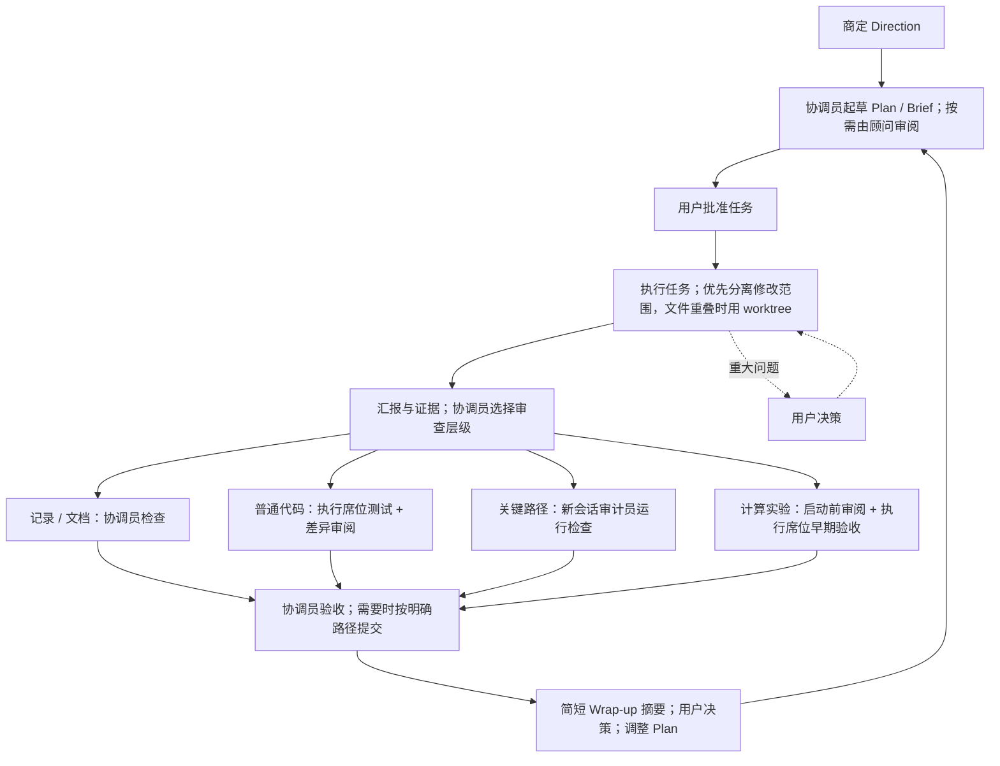

[English](README.md) | 中文

# agent-co-work

一套可移植的多智能体协作套件，适用于类 Unix 主机（macOS/Linux）上的任意项目目录，基于 Herdr（`hc`）与单个标准库 Python CLI（`cw`）构建。
你与协调员商定方向、批准每个任务、裁决重大问题，并审阅协调员给出的结论优先摘要；顾问按需提供审阅。
任意席位都可运行任意受支持的 agent CLI（`claude`、`codex`、`agy`）；三 agent 配置仅作示例，权威协作规则以 [cowork 技能](skills/cowork/SKILL.md#task-loop) 为准。

## 快速开始

前提：macOS/Linux、Python 3.9+、已配置 GitHub SSH 访问的 `git`、Herdr 应用与 `hc` 0.1.22+，以及 `claude`、`codex`、`agy` 中至少一个 CLI（见[环境要求](#环境要求)与[使用 Herdr 应用](#使用-herdr-应用)）。

1. **每台机器只需一次**，将发布仓库克隆到固定位置：

   ```sh
   git clone git@github.com:YitaoXU/agent-co-work.git ~/.agent-co-work
   ```

2. **新项目**：在 Herdr 应用标签页中打开项目根目录，在该标签页启动协调员（例如 `claude -n yyyymmdd-coordinator`），粘贴下方的[协调员提示词](#协调员提示词)。若要手动安装，在同一标签页的项目根目录运行：

   ```sh
   git -C ~/.agent-co-work pull --ff-only
   python3 ~/.agent-co-work/bin/cw init
   ```

   检查席位表、文件计划和 kit 版本，确认后执行：

   ```sh
   python3 ~/.agent-co-work/bin/cw init --apply
   cowork/cw lint
   ```

3. **升级**：在已有项目的协调员 Herdr 标签页中，从项目根目录更新发布仓库并查看升级计划：

   ```sh
   git -C ~/.agent-co-work pull --ff-only
   python3 ~/.agent-co-work/bin/cw init --upgrade
   ```

   确认计划后执行：

   ```sh
   python3 ~/.agent-co-work/bin/cw init --upgrade --apply
   cowork/cw lint
   ```

### 协调员提示词

```text
请在当前项目中安装或升级 agent-co-work。如果 ~/.agent-co-work 不存在，
将 git@github.com:YitaoXU/agent-co-work.git 克隆到 ~/.agent-co-work；
否则运行 git -C ~/.agent-co-work pull --ff-only。
阅读 ~/.agent-co-work/skills/cowork-init/SKILL.md。
首次安装使用 python3 ~/.agent-co-work/bin/cw init；
已有安装使用 python3 ~/.agent-co-work/bin/cw init --upgrade。
向我展示席位表、文件计划和 kit 版本，仅在我确认后，在同一条命令中追加
--apply 执行，然后运行 cowork/cw lint。
```

## 核心概念

- **项目（Project）**：记录在 `cowork/projects/<name>.md` 中的长期工作（`status: active|closed`，包含 `Direction`、`Plan`、`Resources`、`Decisions`），由协调员维护。独立任务可不关联项目。
- **任务（`kind: task`）**：以用户决策收尾的工作单元，运行在 `main` 或 `side` 线上（或 `-`）。每个任务启动前都必须获得用户批准，多个已批准任务可并行推进。
- **步骤（`kind: step`）**：任务内部的具体工作（评审、实现、审计、修复、检查），可记录在任务的 `State` 中，也可新建带 `parent: <task>` 的独立步骤文件。协调员会话使用 `kind: seat`。
- **席位（Seats）**：`cowork/seats.tsv` 中定义的命名角色（`coordinator`、`coordinator-alt`、`advisor`、`coder-heavy`、`coder-light`、`auditor`），将各角色映射到受支持的 agent CLI、模型、推理强度（effort）、生命周期（`short` 子终端或 `long` 无父终端），以及可选的带引号额外 CLI `args`。
- **`cowork/` 文件**：`cowork/cw`（内嵌独立 CLI）、`kit-version`（已安装 kit 的提交和来源）、`seats.tsv`（席位表）、`coordinator.addr`（当前活跃协调员终端 ID）、`README.md`（自动生成的总览）、`projects/<name>.md`、路径永不迁移的每日任务记录 `yyyymmdd/<task>.md`、`locks/<resource>` 与 `lessons/`。

## 环境要求

- **宿主系统（macOS / Linux / POSIX）**：`bin/cw` 无条件导入 `fcntl` 并使用 `fcntl.flock` 串行化资源锁；不支持原生 Windows Python。
- **Python 3.9+**：仅使用标准库；`bin/cw` 无第三方依赖。
- **Herdr（`hc` 0.1.22+）**：用于实时启动、审批、状态查看、汇报与交接；离线记录管理与命令预览时不强制要求。
- **Agent CLI（`claude`、`codex`、`agy`）**：只需安装 `cowork/seats.tsv` 或单任务覆盖配置中实际用到的 CLI，不要求全部安装——纯 Claude 配置只需 `PATH` 中有 `claude`。
- **`git`**：用于克隆和更新 GitHub 发布仓库、识别发布版本，以及通过 `cw new --worktree` 创建隔离工作树。安装后的记录管理命令无需 Git。

## 安装细节

固定在 `~/.agent-co-work` 的发布 clone 供所有目标项目共用。安装与升级均通过 `python3 ~/.agent-co-work/bin/cw` 执行，以使用发布版本的最新技能和模板。

**席位**：根据已安装的 CLI 查看[选择席位](#选择席位)，其中包含单 CLI 示例。首次安装前，可向 `init` 传入 `--seat <seat>=<agent>:<model>:<effort>:<life>`（可重复指定）覆盖默认席位；检查新计划后，在完全相同的命令中追加 `--apply`。使用 `cowork/cw seats` 查看已安装的席位表。

**Kit 版本**：首次安装的计划显示 `kit: to <sha>`，版本有变化的升级显示 `kit: from <old|unknown> to <sha>`。首次安装或升级会写入 `cowork/kit-version`，内容为一行 clone 的完整 HEAD 提交和 origin URL（移除 HTTPS 凭据）。`cowork/cw lint` 会输出已安装版本和 `Caps OK.`，供你与计划核对。版本未变时不输出版本变更行。普通 `init` 保留旧项目的版本状态，包括缺失的版本文件；使用 `--upgrade` 才会记录安装的发布版本。部署前检查有关 kit 文件未提交改动或使用开发仓库的告警。

**`init` 会触及的内容**：创建 `cowork/cw`、`cowork/kit-version`（仅首次安装）、`cowork/seats.tsv`、`cowork/coordinator.addr`、`cowork/<today>/coordinator.md`、`cowork/README.md` 和 `cowork/lessons/README.md`；将四个技能（`cowork`、`cowork-init`、`cowork-seat`、`cowork-consolidate`）复制到 `.claude/skills/` 和 `.agents/skills/`；首次安装时向 `.gitignore` 追加缺失的 `cowork/`、`output/`、`.scratch/`、`.tmp/`、`.worktrees/`（计划中列出），向 `AGENTS.md` 追加带标记区块，并向 `CLAUDE.md` 添加 `@AGENTS.md`。已有安装的普通 init 和 `--upgrade` 逐字节保留 `.gitignore`，缺少默认项时提示。普通 init 保留其他已有内容，对已更新的安装重复运行会打印 `nothing to do`。执行 `python3 ~/.agent-co-work/bin/cw init --upgrade`（随后 `--upgrade --apply`）仅刷新 `cowork/cw`、`cowork/kit-version`、复制的技能和 `AGENTS.md` 的标记区块。

**使用服务器的项目**：如果项目在服务器上运行作业，`cowork-init` 的可选步骤会询问 [templates/server.md](templates/server.md) 中的每个占位符，填好规则供用户确认后，保存到 `docs/server.md`（或项目声明的文档路径）。已有服务器指南绝不覆盖，并在 `AGENTS.md` 的标记区块之外添加指针。硬件信息在沙箱外探测前保持未验证状态。

### 使用 Herdr 应用

Herdr 负责显示空间（space）、标签页（tab）和窗格（pane），`herdr-core`（`hc`）负责运行其中的终端并在窗口关闭后保持它们存活（关闭窗格、标签页或空间则会结束其中的终端）。

1. 打开 Herdr 应用，并在应用中为目标项目目录新建空间或标签页（命令面板 `app.palette` 会按名称及快捷键列出包括 `space.new` 和 `tab.new` 在内的所有命令，`app.help` 可开关快捷键对话框；尚未打开任何空间时，新建标签页会自动创建一个空间）。
2. 在该终端中启动 Claude Code：`claude -n yyyymmdd-coordinator`（或你选定的协调员 CLI），然后粘贴“快速开始”中的[协调员提示词](#协调员提示词)。
3. 启动其他席位时，`cowork/cw start` 会把调用方的 `herdr.space=<id>` 标签传给 `hc run` 且不设置 `herdr.tab`，因此 Herdr 会在同一个空间中为每个已启动的席位新建一个标签页。 长席位使用 `--no-parent`，短席位使用 `--parent <调用方 t-id>`。

## 选择席位

`templates/seats.tsv` 中的默认三 agent 配置仅作示例。任何席位都可以使用任意受支持的适配器（`claude`、`codex`、`agy`）及该 CLI 接受的任意模型与推理强度。可选的第六列带引号 `args`（`-` 或留空表示无）用于提供额外适配器 CLI 参数，按 shell 风格引号规则拆分（内层引号可保留空格，不执行 shell 展开）并原样追加到适配器 argv 末尾。

每格依次列出 `agent model effort life`；可选的 `args` 见上文。

| seat | 纯 Claude Code | Claude Code + Codex | Claude Code + agy + Codex（默认配置） |
|---|---|---|---|
| `coordinator` | `claude claude-opus-5-5 high long` | `claude claude-opus-5-5 high long` | `claude claude-opus-5-5 high long` |
| `coordinator-alt` | `claude claude-opus-5-5 high long` | `claude claude-opus-5-5 high long` | `agy gemini-4-neon-xhigh xhigh long` |
| `advisor` | `claude claude-opus-5-5 high short` | `claude claude-opus-5-5 high short` | `agy gemini-4-neon-xhigh xhigh short` |
| `coder-heavy` | `claude claude-opus-5-5 high long` | `codex gpt-6-astra high long` | `codex gpt-6-astra high long` |
| `coder-light` | `claude claude-opus-5-5 high long` | `codex gpt-6.1-sol max long` | `codex gpt-6.1-sol max long` |
| `auditor` | `claude claude-opus-5-5 high long` | `codex gpt-6-astra high long` | `codex gpt-6-astra high long` |

- **修改席位默认值**：初始化阶段可传 `--seat <seat>=<agent>:<model>:<effort>:<life>`（`args` 在初始化后配置）；初始化完成后运行 `cowork/cw seat set [--args='...'] <seat> <agent> <model> <effort> [short|long]`（更新 `cowork/seats.tsv`、保留注释，并在调用方记录中追加一行 `State`）。`--args='...'` 替换额外适配器选项（例如 `--args='--sandbox workspace-write'` 或 `'--config "label=two words"'`），省略 `--args` 则保留现有 `args`，`--args=-` 用于清空；切换适配器时请清空或替换不兼容的选项。
- **为单个任务指定 agent**：向 `cowork/cw new` 传入 `--agent <agent>:<model>:<effort>[:<life>]`，或运行 `cowork/cw set <taskfile> agent=<agent>:<model>:<effort>[:<life>]`（`agent=-` 恢复席位默认值）。省略 `life` 时沿用席位设置，且单任务覆盖会保留该席位的 `args`（因此当席位带有特定适配器的 `args` 时，切换适配器前需先清空或更新这些 `args`）；席位的角色和命名规则保持不变。

- **单任务额外参数**：`cw new ... --args='-a never'` 或 `cw set <taskfile> 'args=-a never'` 将任务参数追加在席位参数之后，三种适配器一致。`args=-` 仅清空任务参数；旧记录缺少该字段时视为空。使用 shell 风格引号但不执行 shell 展开；`args: --label "run # 1" # comment` 保留引号中的井号。无人值守选项只放在需要它的任务上。

## 默认项目布局

项目可在 `AGENTS.md` 中声明文件存放覆盖规则，安装不会搬动现有文件。忽略的证据是本地文件，备份由项目负责。

| 路径 | 内容 | 首次安装时 Git 跟踪 | 持久证据 |
|---|---|---|---|
| `docs/` | 日常指南、设计、已接受结论 | 跟踪 | 是 |
| `docs/archive/` | 过时文字稿的带日期汇编 | 跟踪 | 是 |
| `cowork/` | 每日记录、项目、席位、锁、教训 | 忽略 | 是，本地记录 |
| `output/<yyyymmdd>/<task>/` | 结果、审计发现、日志、汇总的 `log.md` | 忽略 | 是，保护引用路径 |
| `.scratch/` | 主机本地操作回执、调度文件 | 忽略 | 仅操作回执 |
| `.tmp/` | 可丢弃的克隆、沙箱、探测 | 忽略 | 否，先导出必要证据 |
| `.worktrees/` | 可选的隔离检出 | 忽略 | 否，合并或结项后清理 |

各类文件的生命周期、上限和历史位置见 [归纳技能](skills/cowork-consolidate/SKILL.md)。

## 运行流程



`cw start` 检查任务及父任务的批准关卡；`cw new --worktree` 创建 `.worktrees/<task>` 和任务分支，通过 `COWORK_ROOT` 将记录保留在主检出中；详见技能中的 [审查与 Git 规则](skills/cowork/SKILL.md#escalation-and-review)。

## 资源与锁

- **参考预计时间**：`cowork/cw lock expect <resource> <time>` 通知后继任务与协调员，不写入 `State` 行。
- **释放与过期恢复**：持锁方运行 `cowork/cw lock release <resource> [--evidence <path>] [--note <text>]`，先释放锁再发送通知，保留队首设置，并写入一条 `State` 行。`cowork/cw status` 会为已关闭、缺失或已退出的持锁方标出 `! stale holder`（绝不自动释放）；仅协调员席位可使用 `--force --holder <yyyymmdd/task>` 强制恢复。预期持有者在锁内校验和比较；缺失、格式错误或不匹配时退出码为 1，锁不改变。
- **存储方式**：以无扩展名 TSV 文件存于 `cowork/locks/<resource>`，记录 `yyyymmdd/<task>` 标识，通过 `cowork/locks/.flock` 上的 `fcntl.flock` 串行化，并借助 `COWORK_ROOT` 在各 worktree 间共享。

锁命令在变更前失败时返回 1，变更后通知或回执写入失败时返回 3（包括 `expect`）。遇到 3 或结果不明确时，重试前先用 `cw status` 检查 holder/since。`--holder` 能保护其他任务的获取，但不能区分同一任务后来再次获取。详见 [资源规则](skills/cowork/SKILL.md#resources)。

## 记录、Wrap-up 与经验教训

[记录规则](skills/cowork/SKILL.md#records-and-messages) 定义写入归属与不可变证据；[cowork-consolidate](skills/cowork-consolidate/SKILL.md) 覆盖 State、Decisions/Plan、教训、概览/交接、归档、输出/临时文件和记忆。

- `cw report "<conclusion>; <path>"` 向协调员发送带任务前缀的消息。`--to <task>` 优先解析发送方同日记录，否则使用最新同名记录，发送给活跃目标并抄送协调员；目标缺失则只通知协调员。每个直接收件方都有送达回执。
- 报告发送最多尝试三次，每次约 180 秒，整条命令共用 10 分钟预算（含 `--to` 的两个收件方）。每次重试前读取目标屏幕；正文已显示则视为送达，不再重发。进度写入 stderr，仅最终结果产生回执。任务投递、按键、启动及其他通知保持原有行为。
- 协调员报告失败时追加 `REPORT (undelivered):`；随后相同正文和目的地送达时追加 `REPORT (delivered):`，保留失败记录。普通首次成功不新增 State 行。`cw status` 标记未解决回执，包括已关闭或未分配终端的任务；不同正文/目的地互不消除，再次失败会重新标记。
- `cw index` 生成不超过 60 行的概览：按项目/线路分组的活跃 task/seat，以及近 7 天关闭的记录。step 汇总为父任务行上的计数（同日父任务优先，否则最新）；无父任务的 step 留在每日记录中。溢出时失败，不覆盖概览。
- `cw lessons [yyyymmdd]` 从 Wrap-up/旧 Debrief 刷新每日 From tasks，保留 Takeaways。
- `cw lint` 打印安装版本、校验头部和项目状态，并检查非空节行数：Goal <=3、State <=10、Handover <=20、项目 Decisions <=20。文件上限为教训 README <=40、概览 <=60；项目历史归档不受 Decisions 检查。超过 40 字符的完全重复行仅作为诊断。

任务模板包含 `args: -`，旧 `size:` 和 `debrief` / `## Debrief` 仍可读取。用 `cw set` 修改头部。

## 协调员交接

- 运行 `cowork/cw handover context` 启动全新的 `coordinator`，`cowork/cw handover tokens` 切换到 `coordinator-alt`（或切回），或 `cowork/cw handover --accept` 接管；详见 [交接规则](skills/cowork/SKILL.md#size-limits-consolidation-and-handover)。
- `--accept` 会将继任者的终端 ID 写入 `cowork/coordinator.addr`、向前任协调员发送接管确认并在自己的 `State` 中记录送达情况；离任方的 `cw handover` 会轮询 `coordinator.addr` 以确认交接完成。

## 无 Herdr 模式

- 未设置 `HC_TERMINAL_ID` 时，`cw init --apply` 会将 `cowork/coordinator.addr` 设为 `- -`；记录类命令（`project new`、`new`、`set`、`seat set`、`index`、`lessons`、`lint` 以及锁状态操作）均可离线运行。
- `cowork/cw start <taskfile>`（或随时加上 `--print`）会打印准确的 `hc` 启动命令，不实际启动也不修改记录；`cowork/cw check <taskfile>` 会打印 `hc get` 命令及最后 3 条 `State` 行。
- `cowork/cw status` 列出活跃且已分配终端的任务，以及任何有未解决报告回执的任务，显示 `Herdr unavailable`，同时仍会标出其 `State` 中的 `BLOCKED:` 以及已关闭或缺失的过期锁持有者。
- `cowork/cw report` 会向 `State` 追加 `REPORT (undelivered): ...`、打印供人工转发的 `Relay to coordinator:` 行并以退出码 1 退出；`cowork/cw handover` 必须依赖 `HC_TERMINAL_ID`。

## 故障排查

- **恢复 Claude Code 后终端身份错误**：恢复的会话可能使用另一个会话的 `HC_TERMINAL_ID` 运行工具。用 `echo $HC_TERMINAL_ID` 与 `cowork/coordinator.addr` 核对；若你确实是记录中的协调员，请固定正确值，例如 `HC_TERMINAL_ID=t22 cowork/cw start <taskfile>`。未设置 `COWORK_TASK` 的调用方会在 `start`、`lock next`、协调员的 `lock take` / `release --force`、`handover context|tokens` 和 `seat set` 前接受身份检查。席位调用方、`handover --accept`、`report` 及无 Herdr 的操作不受影响。

- **信任与权限提示**：`cw start` 和 `cw handover` 仅在以下两种情况调用 `cw approve`：(a) 路径与项目根目录精确匹配的文件夹信任提示（`cw start` 中也可为任务指定的 worktree）；(b) `agy` 对普通 `cowork/cw ...` 命令的权限提示（选择 "always allow in this conversation"）。独立 `cw approve` 仍只接受根目录，同级目录不获准。其他任何提示或重复出现的不匹配提示都会输出屏幕末尾内容并以退出码 2 中止，不会按键；可用 `hc read <t> --lines 0` 查看并手动处理，或对可识别提示运行 `cowork/cw approve <t>`。
- **Codex 启动因账号错误退出**：若 Codex（或其他 agent）在任务确认尚未送达时提前退出（例如启动时出现账号或路由错误），`cw start` 会读取并打印屏幕末尾内容、移除该失败终端记录，并在原 120 秒启动时限内以相同名称重新启动一次。若第二次仍提前退出（或清理失败），则会打印屏幕末尾并停止，不更新任务头部；请检查打印的尾部输出（若第二个终端仍在，也可运行 `hc read <name> --lines 0`）、排查 Codex 登录/账号状态，再重新执行 `cowork/cw start <taskfile>`。已送达或送达状态不明确的任务绝不会自动重启，且 `cw handover` 不会自动重启。
- **嵌套项目询问是否允许外部 `CLAUDE.md` 导入**：`cw init` 会向 `CLAUDE.md` 写入 `@AGENTS.md`。在嵌套项目中，Claude Code 可能会询问是否允许导入外部 `CLAUDE.md`；由于这不属于可识别的根目录文件夹信任提示，`cw approve` 会刻意拒绝按键（输出屏幕末尾并以退出码 2 退出），请在 Herdr 中手动确认或拒绝该对话框。
- **agy 状态滞后**：Herdr 可能在生成结束前就把 `agy` 报告为 `done`。请以席位发出的 `cw report` 消息为准，不要仅凭终端状态判断，并可通过 `cowork/cw check <taskfile>` 查看进展。

## 命令参考

<details>
<summary>全部 <code>cw</code> 命令（全局参数：<code>--root &lt;dir&gt;</code>）</summary>

| 命令 | 用途 |
|---|---|
| `python3 ~/.agent-co-work/bin/cw init [--seat seat=agent:model:effort:life] [--upgrade] [--apply]` | 从固定 GitHub 发布 clone 安装或升级；规划版本，并在首次安装或升级时写入 `cowork/kit-version` |
| `cw seats` | 打印 `cowork/seats.tsv` |
| `cw seat set [--args='...'] <seat> <agent> <model> <effort> [life]` | 更新单个席位配置（省略 `--args` 保留原值，`--args=-` 清空）并追加一行 `State` |
| `cw project new <name>` | 创建 `cowork/projects/<name>.md` |
| `cw new <task> --seat <seat> (--kind task\|step \| --size large\|small) [--project <name>] [--line main\|side\|-] [--parent <task>] [--agent agent:model:effort[:life]] [--args='...'] [--worktree]` | 创建 `cowork/<today>/<task>.md`（及可选的 `.worktrees/<task>`） |
| `cw set <taskfile> key=value ...` | 编辑经校验的任务 frontmatter 字段 |
| `cw start <taskfile> [--print]` | 在 Herdr 中启动经关卡检查的任务/步骤，或仅打印启动命令 |
| `cw check <taskfile>` | 显示终端 `hc get` 状态及最后 3 条 `State` 行 |
| `cw approve <terminal>` | 自动响应可识别的根目录信任或 `agy` 的 `cowork/cw` 提示（否则退出码 2） |
| `cw status` | 列出活跃已分配终端和未解决报告（`blocked`、`error`、`exited`、`BLOCKED:`、`undelivered report`）及锁状态（`! stale holder`） |
| `cw lock next <resource> <task\|->` | 协调员设置或清空唯一队首 |
| `cw lock take <resource>` | 为调用方任务获取空闲或排队就绪的锁 |
| `cw lock expect <resource> <time>` | 向后继任务与协调员发送参考释放时间 |
| `cw lock release <resource> [--evidence <path>] [--note <text>] [--force --holder <yyyymmdd/task>]` | 释放锁、通知后继任务与协调员并写入一条 `State` 行（`--force --holder` 仅限协调员；变更后失败返回 3） |
| `cw report [--to <task>] "<conclusion>; <path>"` | 向协调员汇报（可选同时发给活跃任务终端） |
| `cw handover [context\|tokens \| --accept]` | 启动继任协调员或接管 `coordinator.addr` |
| `cw index` | 重新生成 `cowork/README.md` |
| `cw lessons [yyyymmdd]` | 将 Wrap-up/Debrief 中的 `- lesson:` 汇总到 `cowork/lessons/<date>.md` |
| `cw lint` | 输出已安装的 `cowork/kit-version`；检查记录行数上限、项目/任务校验以及重复行 |

</details>

## 已知限制

- **固定适配器集合**：内置启动与审批适配器仅支持 `claude`、`codex` 和 `agy`；未知 agent 会报错。
- **严格限定的自动审批**：仅自动处理可识别的提示，详见 [故障排查](#故障排查)。
- **无加密级强约束**：`approved: user, yyyy-mm-dd` 与席位角色只做格式/日期校验，不构成防止手动篡改的安全边界。
- **有界启动重试与人工恢复**：启动恢复详见 [故障排查](#故障排查)；过期锁只会标记（`! stale holder`），永不自动释放。
- **命名与可见性上限**：名称限 1–20 字符（`[a-z0-9]([a-z0-9-]{0,18}[a-z0-9])?`），冲突后缀最多到 `-9`，调用方无 `herdr.space` 标签时会发出警告并以隐藏终端启动。
- **单元测试范围**：`tests/` 使用隔离的模拟 `hc`/`git` 二进制、本地 Git clone 测试仓库、捕获的提示界面文本以及真实的并发锁竞争进程；实机多 agent 交接未纳入自动化测试套件。

## 开发说明

- **目录结构**：`bin/cw`（单个纯标准库 Python 3 脚本）、`skills/`（`cowork`、`cowork-init`、`cowork-seat`、`cowork-consolidate`）、`templates/` 与 `tests/`。
- **单一规则来源**：协作规则只维护在 [skills/cowork/SKILL.md](skills/cowork/SKILL.md)（上限 150 行）；其余三个技能仅链接至此，不重复陈述规则。
- **日常校验**：在 kit 仓库中运行 `python3 -m unittest discover tests`；在已初始化的项目中运行 `cowork/cw lint`，校验该项目的协作记录。
